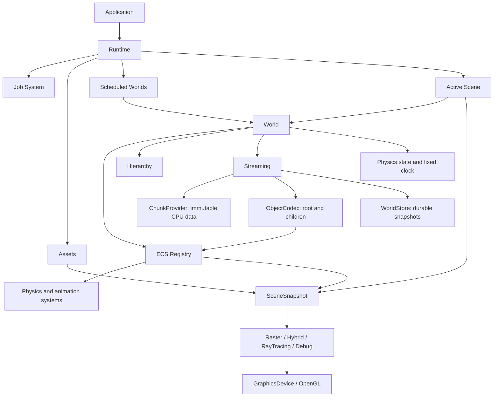

# Jade Architecture

## Ownership and dependency direction

World defines what exists and owns the state needed to resume its simulation. Registry supplies storage, component queries and generation-safe identities. Scene supplies the camera, view navigation, local events and modules for a World. Physics interprets Collider/RigidBody state; Renderer consumes a detached immutable snapshot. Providers and codecs are supplied by the game, so Jade does not depend on Untitled content types.

Core provides jobs, events, time and logging. Runtime composes services; it does not put graphics dependencies into World or ECS. Assets and GPU resources have separate ownership. The public native `Physics::World` is the physics kernel; `Jade::World` is the application-world owner. These types serve different boundaries and are not aliases.

## Frame scheduling

Application polls input, dispatches Application/Scene FrameUpdate, then ticks Runtime and captures the active view. Runtime deduplicates explicit Worlds and the active Scene's World. Each World advances streaming on its owner thread, commits commands, then accumulates its own fixed-step clock. For each substep it runs its fixed gameplay callback, commits structural commands, synchronizes physics, advances the native kernel and publishes Transform/RigidBody results. Worlds without fixed gameplay callbacks synchronize/publish once around their substeps. Ownership migration follows simulation; animation resolves before rendering.

Physics defaults to 1/120-second steps and eight substeps per frame. Fractional time remains per World; excess whole steps contribute to dropped-time statistics. Paused Worlds clear clock debt and retain simulation state. Run/minimize boundaries reset clock debt. Switching views within one World retains its clock, bodies and contact state. Explicitly scheduled Worlds continue simulating when Scene is absent; an implicitly scheduled World stops when its last active view is removed.

Registry and hierarchy mutation, codec execution and lifecycle publication run on the owner thread. Physics jobs work on private buffers; ray jobs work on immutable render snapshots; streaming jobs capture only immutable Provider/Store and task-result objects. Accepted work never captures a live World. Runtime drains jobs before releasing ownership and detaches job pointers from retained Worlds.

## ECS storage and mutation

Each component type owns 256-slot stable pages and a sparse entity-to-slot lookup. Numeric type IDs select pools; entity signatures index matching groups. Signature groups store identities, not movable component columns. Thus references survive unrelated component insertion and signature transitions. Vacated slots return to an intrusive free list after destruction. Generation counters prevent stale entity access, including after component constructors destroy their owner.

`query<T...>()` returns a sorted identity snapshot with removal skipping. `each<T...>()` visits matching groups without an identity snapshot. Batch traversal forbids create/destroy/add/remove/reparent and command commit; callers queue World commands for a boundary. Values can change during traversal. Revision APIs describe edits for consumers that opt into them; snapshots and save codecs read actual values rather than trusting revision counters.

Destruction first prepares retirement actions and invalidates the complete subtree, then runs child-before-parent component destructors. Retirement retains pool storage so reentrant callbacks can create or destroy unrelated entities. Constructors can edit other components; recursive construction of the same component on one entity throws. Hierarchy links live in storage as a mechanism; World applies ownership policy and rejects cycles, foreign entities, streamed-root parenting and cross-Chunk attachments.

## Streaming and world data

The streaming manager unions independent data/render/collision/simulation requirements from one or more sources. CPU-only resident Chunks contain data without entities. Runtime demand materializes codec roots and children transactionally. A failed spawn rolls back the supplied root and all its attached children before publication. Physics, renderer and animation check Residency; dynamic bodies outside simulation demand freeze and are excluded from collision even if static collision demand remains.

Loading and durable saves use bounded Asset jobs. Results commit on the owner thread only when current demand still requires them. Obsolete results are discarded. Runtime commits and releases are independently budgeted; hysteresis suppresses repeated load/unload at borders. Required demand above the resident capacity produces an explicit diagnostic instead of claiming readiness. Ordinary updates do not wait for I/O; explicit barriers wait at startup or controlled teleport boundaries.

WorldId/ObjectId identify persistent roots independently of Entity handles. A codec owns its versioned JSON schema and child representation. Immutable authored Chunk data combines with saved overlays and tombstones. Migration moves the ownership record while preserving the live identity; missing destinations and the source are pinned until the destination is materialized. Pending roots freeze, and persistence records their actual destination independently of the temporary live owner. A whole-world snapshot commits the source override and destination ownership together.

Before unloading or dematerializing persistent roots, the manager captures state and obtains durable acknowledgement. It compares current codec values with that acknowledged snapshot before releasing entities, including raw component edits made while the save was in flight. Failed saves keep the only live copy. FileWorldStore flushes a versioned immutable snapshot, then replaces the commit manifest atomically on Windows. Pending/unreferenced files do not supersede the manifest. Current and previous snapshots are retained; one writer owns each save directory.

Detailed API, error and lifecycle contracts are in [WorldRuntime.md](WorldRuntime.md).

## Geometry and rendering

Geometry distinguishes immutable mesh resources, analytic unit spheres and finite XZ planes. Snapshot capture composes intrinsic radius/size with the full object transform and attaches cached raster tessellation. Geometry choice is independent of Collider choice. Nonuniformly scaled analytic spheres become ellipsoids for ray rendering; sphere Collider validation still requires uniform scale.

CPU RayScene and GPU compute transport intersect analytic shapes in object space without normalizing the transformed ray direction, preserving the world-space ray parameter. Normals use inverse transpose, bounds enclose the exact shape and hit errors support robust secondary origins. Mesh geometry retains BLAS/TLAS acceleration. GPU Hybrid packs analytic primitives and inverse matrices into its shadow BVH; CPU Hybrid uses RayScene. Raster/shadow maps/debug use tessellation.

Mesh emitters use triangle area distributions. Analytic spheres sample local surface area; planes sample their finite rectangle. World-space density divides by `abs(det(M)) * length(M^-T n)`, accounting for nonuniform scale. Shape selection uses estimated transformed area as a sampling weight; the actual conditional PDF uses the local Jacobian. Materials, emission and CPU/GPU BSDF behavior are shared across geometry representations.

Renderer::System selects Raster, Hybrid, RayTracing or None over SceneSnapshot. Raster/Hybrid share upload, geometry/lighting and composite passes. Hybrid traces visibility rather than using shadow maps. CPU/GPU RayTracing remain progressive transport backends. F1 wireframe, F3 axes/bounds, F4 physics, F5 normals and text HUD are independent debug drawing. Device-specific GL resources and synchronization stay under internal/Renderer/Device/OpenGL.

Realtime passes approximate up to eight direct lights, ambient light and opaque tinted dielectrics. Open emissive surfaces use center area samples; closed emitters use isotropic point approximations. Reflections, refraction and indirect light remain tracer features. F2 observer navigation does not replace the game camera or stop World updates. Its path diagnostics sample the game camera on CPU at a bounded rate.

## Physics, animation and assets

Each World owns native bodies, binding handles, immutable force fields and integration settings. Physics::System synchronizes ECS state and publishes results; native physics remains usable without ECS or a window. Empty Collider or disabled Residency suspends a bound body while retaining state. Dynamic bodies require root Transforms. Solver, queries and CCD details are documented in [Physics.md](Physics.md).

Animation runs on World Registry, updating Animator/SpriteRenderer only under simulation Residency. Paused Runtime resolves clip changes without advancing time. Immutable animation clips and textures belong to Assets; render snapshots retain resources after World entities disappear. Sprite quads use frame regions, alpha cutout and upright camera-facing transforms. CPU/GPU tracing and raster/Hybrid agree on nearest sRGB texture sampling and alpha rejection.

## Public boundary map

| Public path | Responsibility |
| --- | --- |
| World/World.hpp | Lifecycle, hierarchy, world simulation and commands |
| World/Streaming.hpp | Sources, providers, codecs, persistence and stable references |
| ECS/Registry.hpp | Component storage access, views, batch traversal and revisions |
| Core/Entity.hpp, Core/Archetype.hpp | Generation-safe identity and type-only descriptors |
| Core/Scene.hpp | World reference, camera, view input and local modules |
| Runtime.hpp, Application.hpp, EngineConfig.hpp | Scheduling, services, window loop and configuration |
| Graphics/Geometry.hpp, Graphics/Mesh.hpp | Shape authoring and immutable raster resources |
| Physics/World.hpp, Physics/System.hpp | Native physics kernel and ECS bridge |
| Renderer/Common/SceneSnapshot.hpp | Detached shared geometry, material, light and camera snapshot |
| Renderer/System.hpp, Renderer/RenderPipeline.hpp | Pipeline and device/pass contracts |
| Assets/, Animation/, Materials/, Math/ | Immutable resources and reusable value types |
| Events/, Input/, Module/ | Ordered events and Scene-local navigation |

Public headers do not expose GLFW, GLAD, Windows or JSON implementation headers. Entity/Registry/World construction requires no renderer. CMake lists source files explicitly and standalone public-header compilation checks the boundary. Logging and event propagation remain independent services; [Events.md](Events.md) documents ordering and consumption.
