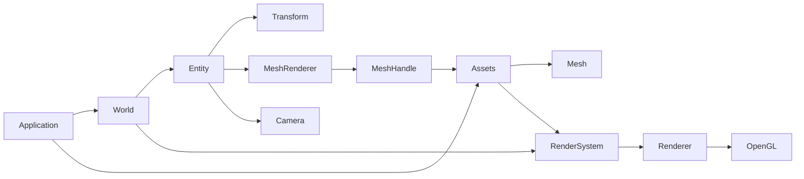

# Jade Architecture

## Core model and boundaries

Entity identifies an existence in World. Components describe its state, systems interpret that state, and Assets owns shareable resources. The current foundation contains World/Entity, Transform, MeshRenderer, Camera and mesh assets. Physics, materials, light, prefabs and a general system scheduler are outside this implementation.

| Public path | Contract |
| --- | --- |
| Core/Entity.hpp | Copyable identity, component access, validity/generation |
| Core/World.hpp | Entity/component ownership, destruction and snapshot queries |
| Core/Transform.hpp | Position, quaternion rotation, scale |
| Assets/AssetHandle.hpp | Typed weak identity; MeshHandle alias |
| Assets/Assets.hpp | Immutable resource snapshots and synchronous OBJ cache |
| Math/Vector.hpp, Math/Quaternion.hpp | Vec2/Vec3 arithmetic and quaternion rotations |
| Graphics/Mesh.hpp, Graphics/Vertex.hpp | Indexed CPU mesh, topology and builders |
| Graphics/MeshRenderer.hpp | MeshHandle and per-entity color |
| Graphics/Camera.hpp | Projection mode, FOV, height and clip planes |
| Graphics/Motion.hpp | Transform movement/rotation/directions and Camera zoom |
| Input/, Events/ | Typed input values, events and connection handles |
| Application.hpp | World/Assets access, active camera and main loop |
| Color.hpp, WindowConfig.hpp, Log.hpp | Shared values, window configuration and logging |
| Jade.hpp | Optional includes-only entry point |

Headers work independently. No folder aggregation header or legacy Object compatibility layer remains. Geometry consists of Mesh builders and Lines/Triangles topologies, all in 3D world space. Window/Renderer/FramebufferSize stay private. Consumer include paths expose neither backend headers nor implementation storage.

Each maintained .cpp includes its corresponding private .hpp first; CMake lists every source explicitly. Data-only headers need no empty .cpp. Core/World.hpp includes no graphics or platform dependency. Public template operations use type-erased bridges implemented in Core and Assets.

## Logging

The public `Jade/Log.hpp` exposes one `Jade::Log` API: Logger, Entry, Level, Config,
Record, Configure, SetLevel, Enabled, lowercase severity factories and Flush.
Each Logger owns a category name and shares output configuration; const insertion
reads that name without modifying the Logger.
`logger << info(...)` consumes an owning, move-only Entry; chaining is supported.
Move construction/assignment transfers the entry's ability to emit, and insertion
consumes it even if the current threshold filters it. Entries never emit from a
destructor. The previous Info/Error helpers and public Write API are removed
without compatibility wrappers or implicit default categories. C++20 format
templates bridge to `src/Core/Log.cpp`; backend state, locking and I/O stay private.

Logging uses process-wide configuration rather than Application ownership so GLFW
initialization errors, multiple windows and repeated Runs share the same policy.
Defaults enable terminal output from Debug upward in both build configurations; an append-only file and one
structured callback are optional. Application controls use category Application,
backend diagnostics use OpenGL/GLFW, and file loads/errors use Assets. Application
logs readiness and Run lifecycle at Info, with an Error record on exception abort.
Its constructor does not overwrite an explicit process-wide logging configuration.

EventDispatcher uses Events for Debug subscription/cancellation records and
key/button edges. Trace covers Held, cursor, scroll and FrameUpdate. One shared
dispatch implementation preserves snapshots, exact matching and ordered
propagation while counting invoked handlers and identifying consumption by a
dispatcher-local subscription ID. Callback failures emit Error with binding and
exception reason before rethrowing the original exception. Cancellation records
are emitted after the next prune removes inactive slots; handles stay immediate
and noexcept. Logging never holds a live container iterator across a sink call.
Events diagnostics obey the global threshold independently of logPerformance.

ApplicationConfig.logPerformance replaces logFrames, defaults to true and controls
performance diagnostics. The allocation-free internal FrameDiagnostics aggregates
one-second windows and reports Debug summaries under Performance. It keeps frame
intervals (including pacing) separate from work wall time (held/update callbacks
through present, excluding the explicit pacing wait). GPU timing is not inferred.
Trace emits individual frames under Frame only when explicitly enabled. Hitches
exceeding max(100 ms, three target periods) emit at Warn at most once per second.
Each Run resets measurements; minimizing drops the previous interval and summary
window, excluding suspension and first-frame warmup. Scheduler counters remain
internal and tested rather than being printed on each frame.

Assets emits Debug load records only after successful cache publication. Errors
carry the path and exception message and are rethrown; path conversion for a log
cannot invalidate a successfully loaded asset or mask its original failure.

Output follows `HH:MM:SS.ffffff LEVEL [Logger] - message` using local time and
six-digit microseconds; severity is right-aligned to five columns. Console colors
are enabled only for native terminal streams, using GetConsoleMode/SetConsoleMode
on Windows and isatty on POSIX. Replaced C++ stream buffers, redirected files/pipes,
nonempty NO_COLOR and TERM=dumb disable color. Timestamps are gray and severity
colors reset before the category/message. File output always uses the plain format.

An atomic threshold avoids formatting disabled entries at creation. Entries format
and own their payload immediately; insertion rechecks the threshold, then captures
the record timestamp and Logger name. Filtered entries cannot be revived by a later
threshold change. A mutex serializes the
built-in outputs and configuration changes. A callback snapshot runs outside the
mutex; concurrent callbacks may overlap and arrive in a different order from file
lines. Per-thread recursion suppression permits callback logging without invoking
it again. Records own strings so consumers can copy them into a future editor
console. Sink/format/output exceptions are contained by the logging boundary;
configuration errors propagate before replacing state. Flush applies to built-in
outputs, and Error/Fatal flush the file immediately. Fatal does not abort.

The imported `.temp/log` implementation is reference material only. Its two APIs,
SDK bridge, destructor-driven emission, asynchronous queue, route tables, scope
propagation, subscription registries, queue metrics and runtime config parser are
not part of Jade. The synchronous design is sufficient for the current frame and
startup diagnostics; buffering can be added privately if measured I/O costs justify
it, with explicit queue capacity, overflow and shutdown policies at that time.

## World ownership and query semantics

World owns one private Registry with generation-bearing slots, free indices and type-indexed component pools. Entity contains a weak Registry reference plus slot index/generation. Its 64-bit id packs generation above index, unique within its World. Equality includes the owner. Reuse increments generation; exhausted generations retire the slot. Default, destroyed and expired handles cannot access data. Foreign World destruction is rejected.

world.create() makes an empty identity. Plain user structs and noncopyable components require no base. add<T>(args...) constructs a component; duplicate add throws logic_error, get missing throws out_of_range, and remove absent is a no-op. Invalid entity operations throw logic_error; has returns false. const handles have mutable access, like a const pointer value. All operations use the main thread.

Component allocations stay in place across unrelated creation/pool growth. Removing a component, destroying its Entity or destroying World invalidates its references. Components are extracted from pools before their user destructors run, permitting ordinary removal/destruction callbacks to mutate World safely. Constructors that destroy/reuse their identity cannot publish into that new generation.

World::each<T...>() snapshots matching identities, then rechecks liveness and component presence before each callback. Callbacks receive Entity and references in template order. New entities and new matches are deferred until the next query. Destruction, slot reuse and missing matches are skipped. Removing/replacing a referenced component during a callback invalidates that reference immediately; callers must stop using it. Nested queries make independent snapshots.

## Assets

Assets owns typed immutable CPU allocations, with one-based resource IDs and weak typed handles. get returns const T&; add copies/moves a resource into an immutable snapshot. References survive later registrations. Handles do not extend owner lifetime. There is no unload or hot reload, so a nonempty handle remains valid until owner destruction. Owner identity rejects foreign, empty and expired handles. Generic user resources can be registered; Mesh is the only file-loaded type.

load<Mesh> resolves a canonical absolute path and synchronously parses OBJ. Repeated paths share one handle/allocation, including normalized relative aliases. Failure publishes neither a resource nor a cache entry; retry is allowed. Files changing after a successful load leave the cached immutable resource intact. Relative paths use the working directory; there are no hidden search paths.

Mesh owns vertices (position/normal), uint32 indices and Lines/Triangles topology. Registration checks finite data, index bounds, primitive grouping and supported draw counts. cube(size) emits 24 vertices/36 indices with hard normals; line(a,b) emits two Vec3 vertices; triangle(a,b,c) emits three vertices with a generated normal. Builtin cube generation lives under src/Graphics/builtins. OBJ parsing and mesh validation are internal, preserving positive/negative face references, convex triangulation, supplied normal seams and generated area-weighted normals. UVs, materials and smoothing groups are discarded.

## Rendering and camera

Application owns Assets, World, Window and Renderer, with Renderer destroyed before Window/context. It creates a default camera Entity with Transform at (3,3,5), rotation aimed at the origin, and Camera data: Perspective, vertical FOV 60, orthographic height 6, near 0.1/far 100. Creating Camera components never selects them implicitly. setCamera requires a live own-World identity with both components. A removed/destroyed active camera causes clear/present only, retaining input, callbacks and logs. Selecting a valid camera resumes scene drawing.

RenderSystem is stateless. It queries Transform+MeshRenderer, resolves each mesh through Assets, computes view/projection/model/normal matrices, and submits Mesh plus DrawParameters. It owns no component data. Renderer and OpenGL backend accept neither Entity nor World nor a public immediate-mode scene API. Debug axes use three immutable internal line meshes and no Entities.

World uses right-handed coordinates with Y up. A quaternion maps local axes into world space: +X right, +Y up, -Z front. Transform model is T*R*S; camera view is inverse rigid pose and ignores scale. Projection uses framebuffer aspect and maps clip Z to NDC [-1,1]. Model positions use projection*view*model and homogeneous division; resizing changes horizontal coverage while preserving vertical FOV/height. Normals use rotation*inverseScale, the inverse transpose of the model's linear part.

Components are data aggregates. Consumers validate when used: finite positions and nonzero finite quaternions, positive model scales and dimensions, color channels in [0,1], FOV strictly (0,180), positive height/clipping planes and far>near. Both stored lens settings must remain valid, regardless of projection mode. Computed matrices outside float range are rejected. Invalid render data propagates an exception from Run, whose guard permits a later corrected Run.

The OpenGL mesh backend owns one normal-aware shader, VAO, streaming VBO and index buffer. It explicitly packs six position/normal floats per vertex. Indexed GL_LINES uses unlit color; GL_TRIANGLES uses ambient/directional diffuse light. Mesh data is streamed per draw; persistent GPU caching is deferred. BeginFrame clears color/depth, sets GL_LESS with depth writes, viewport and fill/wireframe. Each draw restores prior depth-test/write/function state. Gizmo lines disable depth test/writes to appear over meshes without changing polygon mode. F3 toggles positive unit XYZ axes colored red/green/blue. GL_LINE affects triangle edges only.

Motion operates on Transform; zoom operates on Camera. Translation preserves orientation; forward/right use current local axes and up/down use world Y. lookAt replaces the quaternion using target/up once. Rotation composes normalized quaternion increments about current local axes, with rightward yaw, upward pitch and clockwise roll. There is no pitch clamp or Euler decomposition, so full flips and yaw/pitch after roll remain consistent with view/direction calculations. Zoom bounds the active lens parameter without changing pose/mode/clip planes; changing projection preserves both zoom values.

## Loop, events and build

The main loop polls and dispatches ordered key/button/cursor/scroll events, applies unconsumed Escape/F3 defaults, waits for steady-clock deadlines, dispatches held keys/buttons and FrameUpdate, then clears, renders, presents and logs. Zero-sized framebuffers keep processing edge input but skip held/update/render/logs; restoration resets dt. FrameClock skips expired slots after overruns. frameLimits defaults to 24 FPS; RunOptions::frameLimit independently caps submitted frames. Each Run retains scene/resources/subscriptions and resets timing. stop allows a later Run; nested Run throws.

[Events](Events.md) describes propagation, exact modifiers and connection lifetime. CMake explicitly lists source/header pairs. Demo and tests are independently optional. GLFW/GLAD are private static dependencies; GoogleTest is configured only for tests. Windows Debug/Release use matching /MDd and /MD runtimes. Software builds select llvmpipe before GLFW when no nonempty driver override exists, and release GPU resources with the owning context current. Runtime/asset deployment stays shared across target configurations.

Tests cover World lifetime/generations and mutation snapshots, Assets sharing/cache/lifetime, quaternion direction/view agreement, camera lifecycle, input ordering, timing and real OpenGL pixels/depth for both topologies, projections, normals, resizing, clipping, wireframe and axes. Local screenshots and Demo launch checks stay under ignored build/validation/.
