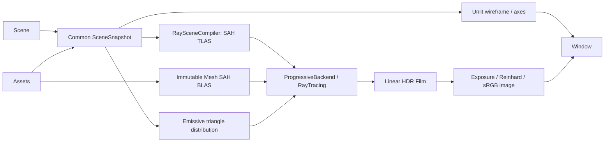

# Jade Architecture

## Core model and boundaries

Entity identifies an existence in Scene. Components describe its state, systems interpret that state, and Assets owns shareable resources. Rendering uses Transform, Geometry, Material and an explicitly selected Camera. The CPU path tracer is independent of the window and OpenGL display.

| Public path | Contract |
| --- | --- |
| Core/Entity.hpp, Core/Scene.hpp | Identity, component ownership, hierarchy and queries |
| Core/Transform.hpp | Local position, quaternion rotation and scale |
| Assets/Assets.hpp, Assets/AssetHandle.hpp | Typed immutable resources and retained snapshots |
| Math/ | Vectors, quaternions and column-major matrices |
| Graphics/Mesh.hpp, Graphics/MeshData.hpp | Immutable compiled Mesh and editable authoring geometry |
| Graphics/Geometry.hpp | MeshHandle component |
| Materials/Material.hpp, Materials/Presets.hpp | Material values, validation and diffuse/metal/glass/emissive presets |
| Graphics/Camera.hpp, Graphics/Motion.hpp | Projection settings and scene motion |
| Renderer/RayTracing/Ray.hpp, Renderer/RayTracing/RayScene.hpp | Ray queries, surface hits, immutable scene compilation |
| Renderer/RayTracing/BSDF.hpp, Renderer/RayTracing/Sampler.hpp, Renderer/RayTracing/Integrator.hpp | Scattering, reproducible samples and light transport |
| Renderer/Common/Image.hpp, Renderer/Common/CameraFrame.hpp | Linear HDR film, sRGB output and camera ray generation |
| Renderer/Common/RenderSettings.hpp, Renderer/Common/RenderProgress.hpp | Sampling resolution/exposure and physical sample progress |
| Renderer/RayTracing/RayTracing.hpp | Multithreaded CPU path tracer |
| Renderer/RayTracing/ProgressiveBackend.hpp | Headless complete-sample contract |
| Application.hpp | Window loop, active Scene, events and RayTracing/Wireframe toggle |
| Module/CameraControl.hpp, Input/, Events/ | Scene-local controls and typed events |
| Jade.hpp | Optional includes-only entry point |

Headers work independently. GLFW, GLAD, Window, GPU programs and render-session storage remain private. Each maintained implementation includes its corresponding private header first and CMake lists sources explicitly. Core does not depend on rendering or platform headers. No compatibility adapters for the old MeshRenderer or lit OpenGL pipeline remain.

## Logging

The public `Jade/Log.hpp` exposes one `Jade::Log` API: Logger, Entry, Level, Config,
Record, Configure, SetLevel, Enabled, lowercase severity factories and Flush.
Each Logger owns a category name and shares output configuration; const insertion
reads that name without modifying the Logger.
`logger << info(...)` consumes an owning, move-only Entry; chaining is supported.
Move construction/assignment transfers the entry's ability to emit, and insertion
consumes it even if the current threshold filters it. Entries never emit from a
destructor. The previous Info/Error helpers and public Write API are removed
without compatibility wrappers or implicit default categories. C++20 format
templates bridge to `src/Core/Log.cpp`; backend state, locking and I/O stay private.

Logging uses process-wide configuration rather than Application ownership so GLFW
initialization errors, multiple windows and repeated Runs share the same policy.
Defaults enable terminal output from Debug upward in both build configurations; an append-only file and one
structured callback are optional. Application controls use category Application,
backend diagnostics use OpenGL/GLFW, and file loads/errors use Assets. Application
logs readiness and Run lifecycle at Info, with an Error record on exception abort.
Its constructor does not overwrite an explicit process-wide logging configuration.

EventDispatcher scopes its logger as Events/Application or Events/Scene:<id> for Debug subscription/cancellation records and
key/button edges. Trace covers Held, cursor, scroll and FrameUpdate. One shared
dispatch implementation preserves snapshots, exact matching and ordered
propagation while counting invoked handlers and identifying consumption by a
dispatcher-local subscription ID. Callback failures emit Error with binding and
exception reason before rethrowing the original exception. Cancellation records
are emitted after the next prune removes inactive slots; handles stay immediate
and noexcept. Logging never holds a live container iterator across a sink call.
Events diagnostics obey the global threshold independently of logPerformance.

ApplicationConfig.logPerformance replaces logFrames, defaults to true and controls
performance diagnostics. The allocation-free internal FrameDiagnostics aggregates
one-second windows and reports Debug summaries under Performance. It keeps frame
intervals (including pacing) separate from work wall time (held/update callbacks
through present, excluding the explicit pacing wait). GPU timing is not inferred.
Trace emits individual frames under Frame only when explicitly enabled. Hitches
exceeding max(100 ms, three target periods) emit at Warn at most once per second.
Each Run resets measurements; minimizing drops the previous interval and summary
window, excluding suspension and first-frame warmup. Scheduler counters remain
internal and tested rather than being printed on each frame.

Assets emits Debug load records only after successful cache publication. Errors
carry the path and exception message and are rethrown; path conversion for a log
cannot invalidate a successfully loaded asset or mask its original failure.

Output follows `HH:MM:SS.ffffff LEVEL [Logger] - message` using local time and
six-digit microseconds; severity is right-aligned to five columns. Console colors
are enabled only for native terminal streams, using GetConsoleMode/SetConsoleMode
on Windows and isatty on POSIX. Replaced C++ stream buffers, redirected files/pipes,
nonempty NO_COLOR and TERM=dumb disable color. Timestamps are gray and severity
colors reset before the category/message. File output always uses the plain format.

An atomic threshold avoids formatting disabled entries at creation. Entries format
and own their payload immediately; insertion rechecks the threshold, then captures
the record timestamp and Logger name. Filtered entries cannot be revived by a later
threshold change. A mutex serializes the
built-in outputs and configuration changes. A callback snapshot runs outside the
mutex; concurrent callbacks may overlap and arrive in a different order from file
lines. Per-thread recursion suppression permits callback logging without invoking
it again. Records own strings so consumers can copy them into a future editor
console. Sink/format/output exceptions are contained by the logging boundary;
configuration errors propagate before replacing state. Flush applies to built-in
outputs, and Error/Fatal flush the file immediately. Fatal does not abort.

The imported `.temp/log` implementation is reference material only. Its two APIs,
SDK bridge, destructor-driven emission, asynchronous queue, route tables, scope
propagation, subscription registries, queue metrics and runtime config parser are
not part of Jade. The synchronous design is sufficient for the current frame and
startup diagnostics; buffering can be added privately if measured I/O costs justify
it, with explicit queue capacity, overflow and shutdown policies at that time.

## Scene ownership, hierarchy and queries

Scene owns one private Registry, a scene dispatcher and a selected camera Entity. It is independently constructible, initially empty and noncopyable. Application retains a shared pointer to its active Scene; consumer references can keep inactive scenes alive. Entity stores a weak Registry reference and slot index/generation. Its 64-bit ID is unique within its Scene; equality also includes owner identity. Reuse increments generation and exhausted generations retire slots. Default, destroyed and expired handles cannot access data.

`scene.create()` makes an empty identity. Plain user structs and noncopyable components require no base. `add<T>(args...)` constructs a component; duplicate add throws logic_error, missing get throws out_of_range, and remove absent is a no-op. Invalid entity operations throw logic_error; has returns false. Const handles have mutable access. All operations use the main thread.

Component allocations survive unrelated creation and pool growth. Removal/destruction invalidates their references. Components are extracted before user destructors run so destructors can mutate the Scene. Constructors that destroy/reuse their identity cannot publish into the new generation.

`Scene::view<T...>()` is an iterable snapshot of weak identities. Advancing rechecks liveness and required components, skipping destruction, slot reuse and removed matches. New entities/matches wait for the next view. Views own their snapshots but do not keep Scene alive; iterators require their view to remain alive. Nested views are independent. Removing/replacing a component invalidates its references immediately.

Registry owns parent links and attachment-order children, exposed through Scene::setParent/parent/children. Parent changes validate liveness, ownership and cycles before mutation and retain local TRS. No Transform is required for an identity group; removing Transform preserves relationships. Destruction collects a complete subtree iteratively, invalidates every identity before any destructor, extracts all components, then releases them children before parents. Destructors can create/reuse slots safely without joining the already selected destruction set.

Scene::worldMatrix resolves full ancestor × local matrices. Rendering creates a fresh ancestor cache per pass, so direct component writes need no dirty flags. Full matrices preserve shear under nonuniform scale and rotation. Matrix4 is a public column-major value; construction/validation helpers remain private.

## Scene selection and events

Application owns Window, OpenGLDisplay, a render session, shared Assets and its global dispatcher, with no implicit scene or camera. It selects a shared_ptr<Scene> via setScene; nullptr selects clear/present-only operation. Each Scene retains its own camera and dispatcher while inactive. The same Scene cannot be active or reserved in another Application.

Outside Run, selection commits immediately. During Run, one optional pending pointer records the last request, including unload. A processing pass holds one strong active pointer through input, update and render. At the next pass boundary it dispatches old SceneDeactivated, commits the pointer, then dispatches new SceneActivated. Reentrant lifecycle requests queue another selection rather than recurse. Selecting the current scene emits nothing.

Lifecycle Stop affects listeners only. Deactivation exceptions retain the old scene; activation exceptions retain the new one. The unused reservation and pending requests are released on failure and the original exception propagates. Input/update exceptions also discard queued switches. Normal bounded Run exit leaves a queued request for the next Run. Application destruction releases its ownership without invoking user lifecycle callbacks.

Ordinary events dispatch globally first, then to the retained active scene, then to unconsumed built-in Escape/F3 handlers. Stop prevents downstream propagation; consumed FrameUpdate still renders. Inactive scenes receive neither input nor update. Switches reset dt/diagnostic windows/pacing, with dt=0 on the first new frame, while Run elapsed and frame counts continue. Physical held keys/buttons remain intact; no synthetic transitions are introduced. Scene destruction expires its connections; Application destruction expires global connections.

## Assets

Assets owns typed immutable CPU allocations, with one-based resource IDs and weak typed handles. get returns const T&; share returns shared_ptr<const T> that retains the resource independently of Assets; add copies/moves a resource into an immutable snapshot. References survive later registrations. Handles do not extend owner lifetime. There is no unload or hot reload, so a nonempty handle remains valid until owner destruction. Owner identity rejects foreign, empty and expired handles. Generic user resources can be registered; Mesh is the only file-loaded type.

load<Mesh> resolves a canonical absolute path and synchronously parses OBJ. Repeated paths share one handle/allocation, including normalized relative aliases. Failure publishes neither a resource nor a cache entry; retry is allowed. Files changing after a successful load leave the cached immutable resource intact. Relative paths use the working directory; there are no hidden search paths.

MeshData owns editable vertices (position/normal) and uint32 triangle indices. Mesh::compile validates finite data, index bounds and complete triangle grouping, then builds an immutable SAH BLAS. Mesh copies share compiled storage; data() exposes authoring geometry read-only. Assets::add(MeshData) compiles before registration and load<Mesh> compiles after OBJ import. Asset/cache publication is transactional. Scene compilation performs no BLAS construction. MeshData::cube(size) emits 24 vertices/36 indices with hard face normals; MeshData::triangle(a,b,c) generates a normal. MeshData::sphere(radius, segments=32, rings=16) emits a closed indexed surface with smooth radial normals, shared poles and wrapped longitude indices. Sphere radius defaults to 0.5. Builtin generation lives under src/Graphics/builtins. OBJ parsing preserves positive/negative references, convex triangulation, supplied normal seams and generated area-weighted normals. OBJ UVs, material declarations and smoothing groups are discarded; Material is explicit scene data.

## Rendering and camera

Scene::setCamera requires a live own-Scene identity with Transform and Camera. Creating Camera components never selects them implicitly. A removed/destroyed active camera causes clear/present only, retaining input and callbacks. Selecting a valid camera resumes geometry and axes.

Application owns one RayTracing instance configured by ApplicationConfig::rayTracing. rayTracing() exposes it for Integrator configuration outside Run. Unmodified I toggles the retained wireframe state independently of ApplicationConfig.debug and respects event consumption, modifiers and repeats. The window title identifies RayTracing or Wireframe.

ProgressiveBackend defines sampling settings, naming and algorithm locks. It receives immutable RayScene plus RenderRequest and commits exactly one Film sample, or cancels without commitment. RayTracing is the application implementation; custom Integrators change transport behavior without changing the application modes. The application seals its RayTracing algorithms throughout Run, including wireframe frames.

Private RenderHost owns one RayTracing, one ProgressiveSession/compiler, presentation and diagnostics. Wireframe stops and joins the session and invalidates published images. Returning to RayTracing starts a fresh Film; starting Run in wireframe never starts a sampling coordinator. Algorithm objects, worker pools and mesh acceleration survive mode changes. Run guards stop work and release algorithm locks after exceptions.

The main thread alone accesses Scene, Entity and Assets and performs OpenGL calls. SceneSnapshot::capture copies resolved transforms, materials and camera pose while retaining immutable meshes. A coordinator compiles snapshots and drives the backend; a persistent worker pool processes 16x16 pixel tiles. Worker sampling depends on seed, pixel, sample and dimension, so thread scheduling does not change results. Integrators used by multiple workers must support concurrent const Li calls.

Assets compiles each Mesh BLAS before publishing the resource. RaySceneCompiler consumes precompiled immutable meshes and holds no mesh-build cache. A three-axis 16-bin SAH builder constructs a separate instance TLAS using transformed bounds. Transform-only changes refit a private copy; a cost above 1.5 times its last SAH build triggers reconstruction. Instance layout or mesh changes rebuild; material/camera changes reuse geometry. Mesh intersection transforms rays into object space without normalizing their directions, preserving world ray parameters under nonuniform scale and shear. Shading normals use inverse transpose transforms; geometric normals identify front/back faces. Degenerate triangles are excluded, both sides can intersect, and shadow queries terminate on any occluder. Cancellation checkpoints interrupt TLAS construction/refit; a cancelled compilation returns an empty scene without modifying the last successful cache state. Old published nodes are never changed by refit. BLAS and TLAS share a private binary BVH with near-first traversal, target leaf size 4, depth cap 48, deterministic fallback for inseparable centroids and double-precision SAH costs. Original triangle IDs are preserved through an independent primitive-order array. RaySceneCompiler itself belongs to one coordinator and is not a concurrent mutable service.

PathIntegrator handles emitted radiance, next-event sampling of emissive triangles, BSDF sampling, multiple importance sampling and Russian roulette. Emitter selection uses transformed area times emission luminance. Its immutable distribution is reused across camera changes, ordinary material edits and non-emissive instance motion. Emissive transforms/emission settings or instance-layout changes rebuild it. Diffuse scattering is Lambertian; metals use GGX; dielectrics use Fresnel reflection, refraction and total internal reflection, with smooth and rough variants. Glass assumes a closed mesh separating air from one dielectric; nested media and volumetric absorption are not implemented. Secondary rays use offset surface origins with float error bounds and unrestricted distance. Near/far camera clipping applies only to primary rays. Escaped rays contribute black. There is no ambient term, fixed directional light or implicit environment.

Film accumulates linear HDR radiance as a running mean. A complete sample round resolves exposure, Reinhard tone mapping and linear-to-sRGB encoding into top-left RGBA8 Image data. OpenGLDisplay presents those bytes using a fullscreen triangle without additional lighting or tone mapping. Physical render resolution defaults to the framebuffer dimensions; resolutionScale is explicit. maxSamples=0 accumulates until invalidation or stop, and renderProgress exposes the latest completed revision and sample count.

Ordinary camera, material or transform changes coalesce pending snapshots: the current sample finishes, then the newest snapshot starts with a fresh Film. The previous completed image stays visible during that transition. Scene changes, resize, missing camera, minimization and wireframe toggles cancel work and invalidate the publication epoch. Completed work from an invalidated epoch cannot publish. Shutdown requests cancellation and joins the coordinator and workers before releasing resources. Worker failures propagate from Run, including finite Runs, and the guard permits recovery after correcting the cause.

I switches between RayTracing and independent unlit triangle-edge drawing; debug F provides the same toggle. It never invokes the integrator. Returning to RayTracing starts a fresh physical accumulation. DebugDraw streams transformed GL_LINES; depth tests compare edges and no physical shading runs. F3 draws positive unit XYZ axes in red/green/blue as a debug overlay. Display begins each frame in GL_FILL and does not use polygon mode as its wireframe implementation.

Coordinates are right-handed with Y up. A quaternion maps local +X right, +Y up and -Z forward into parent coordinates. Local models are T*R*S and world models multiply the full ancestry. Camera position inherits the full parent matrix while orientation composes ancestor quaternions without scale. CameraFrame generates perspective or orthographic rays and supplies matching view/projection matrices for wireframe and diagnostics.

Components are data aggregates and are validated when used: finite positions, nonzero finite quaternions, positive model scales, baseColor channels in [0,1], roughness in [0,1], IOR in [1,10], finite nonnegative HDR emission, FOV strictly (0,180), positive height and clipping planes with far>near. Both stored projection settings must remain valid. Computed matrices outside float range are rejected. Nonempty Geometry requires Material; empty Geometry is skipped.

Motion operates on Transform; zoom operates on Camera. Translation preserves orientation; forward/right use current local axes and up/down use parent Y. lookAt replaces the quaternion using target/up in parent coordinates once. Rotation composes normalized quaternion increments about current local axes, with rightward yaw, upward pitch and clockwise roll. There is no pitch clamp or Euler decomposition, so full flips and yaw/pitch after roll remain consistent with view/direction calculations. Zoom bounds the active lens parameter without changing pose/mode/clip planes; changing projection preserves both zoom values.

### Materials and presentation ownership

Material describes physical values. Public headers live under Materials/, with validation and presets in src/Materials/. Jade::validateMaterial has no presentation dependencies. RayTracing evaluates its CPU BSDF from the description; all reflection, refraction and illumination run through the Integrator.

SceneSnapshot capture belongs to Renderer/Common; emissive-triangle compilation belongs to RayTracing. Presentation/ owns Display.vert and ImageDisplay.frag, which upload and present completed sRGB images without additional tone mapping. Debug/ owns Lines.vert and Lines.frag for unlit triangle edges and axes. OpenGLDevice holds only the context and enforces owner-thread access. Programs and buffers are destroyed while the owning context is current.

The four GLSL files are explicit CMake inputs and are embedded during the build; no shader files are needed beside the executable. Embedded names include their stage, such as DisplayVertex and LinesFragment. The CMake generator rejects unsupported stages, invalid identifiers and duplicate symbols. Source layers are Common/, RayTracing/ and internal Host/, Device/OpenGL/, Presentation/ and Debug/.

Interactive zoom multiplies tan(FOV/2), not the angle, and bounds perspective zoom to 1?120 degrees. CameraControl retains the accumulated wheel gesture relative to a lens reference, including unapplied scroll beyond limits, separately for both projections. Reversing the gesture restores the original lens. External edits or camera replacement establish a new reference. Zoom never changes camera pose or geometry transforms.

## Scene modules

Scene::use<T>() invokes static void T::attach(Scene&) once per type and Scene. The private ledger marks installations in progress to reject same-type recursion. Installation checkpoints the scene dispatcher subscription IDs; failure cancels subscriptions created since that checkpoint and removes new nested ledger entries. Existing module registrations survive, and failed installs can be retried. The rollback covers subscriptions and the installation ledger only; arbitrary module side effects remain the module's responsibility. Module types need no constructor, and there is no unload API.

Module::CameraControl lives in the engine and registers scene-local motion, left-button dragging, zoom and lifecycle callbacks. Shared callback state keeps a Scene reference and weak Entity identity without retaining the Scene. Every input resolves the current selected camera and skips missing components. A changed target or activation/deactivation resets drag state. Demo installs this module in each scene and retains only scene construction, animation and scene-selection shortcuts.

ApplicationConfig.debug defaults to false independently of build type and logging. Unconsumed unmodified Pressed I always toggles RayTracing/Wireframe. When debug is enabled, F/F3/O toggle wireframe, axes and the retained scene camera's projection after both dispatcher layers. O checks Transform and Camera and retains pose/zoom/clips. stop or a closed window prevents these actions. Application owns wireframe state, exposed by wireframeEnabled(). Initial axes still follow config.axisGizmo independently of debug.

## Loop, events and build

After committing any pending scene, the main loop polls and dispatches ordered key/button/cursor/scroll events, applies unconsumed Escape/I and enabled F/F3/O defaults, waits for steady-clock deadlines, dispatches held keys/buttons and FrameUpdate, then clears, renders, presents and logs. Zero-sized framebuffers keep processing edge input but skip held/update/render/logs; restoration resets dt. FrameClock skips expired slots after overruns. frameLimits defaults to 24 FPS; RunOptions::frameLimit independently caps submitted frames. Each Run retains scene/resources/subscriptions and resets timing. stop allows a later Run; nested Run throws.

[Events](Events.md) describes propagation, exact modifiers and connection lifetime. CMake explicitly lists source/header pairs. Demo and tests are independently optional. GLFW/GLAD are private static dependencies; GoogleTest is configured only for tests. GLAD's fixed OpenGL 3.3 Core C source and licenses live in vendor/glad. Shader include expansion and embedding use cmake/EmbedShaders.cmake. Configuration and compilation require no Python interpreter, virtual environment, pip or generator packages. Windows Debug/Release use matching /MDd and /MD runtimes. Software builds select llvmpipe before GLFW when no nonempty driver override exists, and release GPU resources with the owning context current. Runtime/asset deployment stays shared across target configurations.

Tests cover kernel contracts, analytic transport checks, deterministic multithreading, BVH agreement with brute force, cancellation/publication and actual OpenGL display pixels. Existing module, lifecycle, assets, input, math, scheduling and logging suites remain maintained. See [Validation](Validation.md) for current build and execution results.
