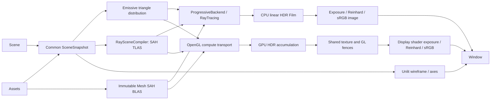

# Jade Architecture

## Sprite animation and Untitled

Runtime also owns `Animation::System`, which updates Animator/SpriteRenderer after
gameplay callbacks and fixed physics steps, before snapshot capture. Paused runtime
ticks resolve changed clips without advancing animation time. Clip resources use
Assets handles rather than pointers to live mutable clip data.

Assets loads PNG Texture resources with Windows WIC and caches canonical paths.
Immutable RGBA8 resources are retained by detached snapshots. Sprite instances use a
shared compiled quad, frame UV region, pivot and an upright camera-facing transform.
Changing only a frame region reuses the existing geometry acceleration.

CPU and GPU ray backends sample the same nearest sRGB texels, convert RGB to linear,
and reject alpha below the instance cutoff before committing a hit. This also applies
to occlusion queries. Sprite quads use local `(x + 0.5, 1 - y)` UVs; this is a sprite
interface, not general mesh UV mapping. Unlit sprites terminate transport with texture
color and are excluded from emissive light sampling. The GPU retains packed RGBA
texels in an SSBO and uploads frame selection separately from mesh geometry.

`CharacterController` is a root-entity planar controller using fresh collision queries
and small displacement steps against static colliders. It has no RigidBody and handles
horizontal correction/sliding at a fixed support height. Untitled owns input, player
states, eight-direction clip mapping, camera rotation, world construction and reset.

## Render pipeline framework

Renderer::System selects RenderMode::Raster/Hybrid/RayTracing/None over a common immutable
SceneSnapshot. Entity/Scene ownership and gameplay components are unchanged. RenderPipeline
receives RenderContext (snapshot, GraphicsDevice, RenderTarget, output settings and frame
budget). Raster and Hybrid compose shared upload, shadow, geometry/lighting and composite
passes; Hybrid uses BVH visibility queries during forward lighting instead of shadow maps.
The backend owns GPU resources, framebuffer depth, shader execution and synchronization.
GL commands live under internal/Renderer/Device/OpenGL; pipeline and debug code issue
device/pass operations. Running tracing frames reserve 6 ms of the frame budget for presentation and window
scheduling, while preserving the complete-sample floor and paused accumulation.
The existing ProgressiveSession, CPU tracer and GPU compute transport
remain the RayTracing pipeline implementation. None submits no normal image-rendering work.

Raster/Hybrid support up to eight direct lights. Graphics/Light.hpp provides directional,
point and rectangular area components, normalized into world-space RenderLight snapshots.
Existing emissive meshes remain physical triangle emitters for tracing. Realtime passes
reduce open emitters to center-sampled area lights and closed emitters to isotropic point
sources with the same total Lambertian flux. Metal highlights and opaque tinted dielectric
surfaces are realtime approximations; reflections and refraction remain tracer features.
Both realtime pipelines use a small ambient approximation. Sprite alpha is tested for
raster fragments, shadow maps and GPU/CPU shadow rays. GPU Hybrid uses a world-space SAH BVH
in OpenGL 3.3 buffer textures. CPU Hybrid uses the shared JobSystem/RayScene and uploads a
visibility mask at rayTracing.resolutionScale; it keeps geometry at full window resolution.

F1 wireframe, F3 scene diagnostics and F4 physics remain overlays. Config.renderer.debugView
controls entity axes, BVH, camera frustums and light directions within F3. Debug line commands
use GraphicsDevice; BVH drawing is bounded. F5 changes output without changing pipeline.
F2's observer is Runtime-owned and never replaces scene.camera(). Its controls consume
movement/look input before global/scene gameplay handlers. The world keeps updating and
the selected pipeline is restored on exit. Runtime samples a 16?9 grid from the latest game
camera snapshot at at most 6 Hz. PathIntegrator::record shares transport with Li and records
primary, bounce, shadow and escape segments without changing random-number consumption.
These are diagnostic CPU samples rather than an exact capture of GPU film samples. The
observer uses a raster background, preserves original billboard geometry for path consistency,
clears on scene switch and restores mouse capture on exit/focus loss.

## Core model and boundaries

Entity identifies an existence in Scene. Components describe its state, systems interpret that state, and Assets owns shareable resources. Rendering uses Transform, Geometry, Material and an explicitly selected Camera. The CPU path tracer is independent of the window and OpenGL display.

Application owns Window, ordered input events and frame pacing. Runtime owns JobSystem, Assets, active/pending Scene selection, Renderer::System and Physics::System. EngineConfig supplies separate Window/Renderer/Physics/Jobs/Debug settings. No Application-level subsystem forwarding API remains. Renderer::System owns the existing RenderHost and progressive session; Physics::System is independently constructible without GPU/window dependencies. Destruction releases Runtime and its render workers before Window.

FrameUpdate executes before Runtime's fixed-step clock. Tick accumulates dt, executes up to eight 1/120-second substeps and preserves the fractional remainder; excess whole-step debt is discarded and logged. Scene switches, minimized windows and Run boundaries clear accumulated time and contact caches. Pause changes clear accumulated time while preserving solved anchors and impulses for inspection and resume. Callback failures discard pending scene changes. Renderer captures only the resulting state. Physics orchestration and gameplay callbacks run on the main thread. Physics computation, scene compilation and ray tiles share the Job System; workers access private physics buffers or immutable render snapshots.

| Public path | Contract |
| --- | --- |
| Core/Entity.hpp, Core/Scene.hpp | Identity, component ownership, hierarchy and queries |
| Core/Archetype.hpp | Type-only, recursively deduplicated component descriptions |
| Runtime.hpp, EngineConfig.hpp | Scene/subsystem ownership, fixed clock and typed settings |
| Core/Transform.hpp | Local position, quaternion rotation and scale |
| Assets/Assets.hpp, Assets/AssetHandle.hpp | Typed immutable resources and retained snapshots |
| Math/ | Vectors, quaternions and column-major matrices |
| Graphics/Mesh.hpp, Graphics/MeshData.hpp | Immutable compiled Mesh and editable authoring geometry |
| Graphics/Geometry.hpp | MeshHandle component |
| Physics/Collider.hpp, Physics/Collision.hpp | Local Box/Sphere components and window-independent Contact queries |
| Physics/RigidBody.hpp, Physics/System.hpp | Linear/angular dynamics, manifolds, impulses and contact solving |
| Physics/Environment.hpp, Physics/Field/ | Scene rules, immutable force/gravity sampling and source snapshots |
| Renderer/System.hpp, Renderer/RenderPipeline.hpp | Pipeline selection, device/pass contracts, overlays and progress |
| Graphics/Light.hpp | Shared directional, point and rectangular area lights |
| Materials/Material.hpp, Materials/Presets.hpp | Material values, validation and diffuse/metal/glass/emissive presets |
| Graphics/Camera.hpp, Graphics/Motion.hpp | Projection settings and scene motion |
| Renderer/RayTracing/Ray.hpp, Renderer/RayTracing/RayScene.hpp | Ray queries, surface hits, immutable scene compilation |
| Renderer/RayTracing/BSDF.hpp, Renderer/RayTracing/Sampler.hpp, Renderer/RayTracing/Integrator.hpp | Scattering, reproducible samples and light transport |
| Renderer/Common/Image.hpp, Renderer/Common/CameraFrame.hpp | Linear HDR film, sRGB output and camera ray generation |
| Renderer/Common/RenderSettings.hpp, Renderer/Common/RenderProgress.hpp | Sampling resolution/exposure and physical sample progress |
| Renderer/RayTracing/RayTracing.hpp | Multithreaded CPU path tracer |
| Renderer/RayTracing/ComputeRayTracer.hpp | OpenGL compute ray casting/path tracing with shared GPU HDR presentation |
| Renderer/RayTracing/RayTracingSettings.hpp | Shared device, algorithm, output, sampling and bounce settings |
| Renderer/RayTracing/ProgressiveBackend.hpp | Headless complete-sample contract |
| Application.hpp | Window/input loop, global events and Runtime access |
| Module/FreeCameraControl.hpp, Module/FPSCameraControl.hpp, Input/, Events/ | Scene-local controls and typed events |
| Jade.hpp | Optional includes-only entry point |

Headers work independently. GLFW, GLAD, Window, GPU programs and render-session storage remain private. Implementations include their corresponding public or private header first and CMake lists sources explicitly. Entity, Scene and component storage do not depend on rendering or platform headers. Runtime connects these boundaries. No compatibility adapters for the old MeshRenderer or lit OpenGL pipeline remain.

## Logging

The public `Jade/Log.hpp` exposes one `Jade::Log` API: Logger, Entry, Level, Config,
Record, Configure, SetLevel, Enabled, lowercase severity factories and Flush.
Each Logger owns a category name and shares output configuration; const insertion
reads that name without modifying the Logger.
`logger << info(...)` consumes an owning, move-only Entry; chaining is supported.
Move construction/assignment transfers the entry's ability to emit, and insertion
consumes it even if the current threshold filters it. Entries never emit from a
destructor. The previous Info/Error helpers and public Write API are removed
without compatibility wrappers or implicit default categories. C++20 format
templates bridge to `src/Core/Log.cpp`; backend state, locking and I/O stay private.

Logging uses process-wide configuration rather than Application ownership so GLFW
initialization errors, multiple windows and repeated Runs share the same policy.
Defaults enable terminal output from Debug upward in both build configurations; an append-only file and one
structured callback are optional. Application controls use category Application,
backend diagnostics use OpenGL/GLFW, and file loads/errors use Assets. Application
logs readiness and Run lifecycle at Info, with an Error record on exception abort.
Its constructor does not overwrite an explicit process-wide logging configuration.

EventDispatcher scopes its logger as Events/Application or Events/Scene:<id> for Debug subscription/cancellation records and
key/button edges. Trace covers Held, cursor, scroll and FrameUpdate. One shared
dispatch implementation preserves snapshots, exact matching and ordered
propagation while counting invoked handlers and identifying consumption by a
dispatcher-local subscription ID. Callback failures emit Error with binding and
exception reason before rethrowing the original exception. Cancellation records
are emitted after the next prune removes inactive slots; handles stay immediate
and noexcept. Logging never holds a live container iterator across a sink call.
Events diagnostics obey the global threshold independently of logPerformance.

EngineConfig.logPerformance replaces logFrames, defaults to true and controls
performance diagnostics. The allocation-free internal FrameDiagnostics aggregates
one-second windows and reports Debug summaries under Performance. It keeps frame
intervals (including pacing) separate from work wall time (held/update callbacks
through present, excluding the explicit pacing wait). GPU timing is not inferred.
Trace emits individual frames under Frame only when explicitly enabled. Hitches
exceeding max(100 ms, three target periods) emit at Warn at most once per second.
Each Run resets measurements; minimizing drops the previous interval and summary
window, excluding suspension and first-frame warmup. Scheduler counters remain
internal and tested rather than being printed on each frame.

Assets emits Debug load records only after successful cache publication. Errors
carry the path and exception message and are rethrown; path conversion for a log
cannot invalidate a successfully loaded asset or mask its original failure.

Output follows `HH:MM:SS.ffffff LEVEL [Logger] - message` using local time and
six-digit microseconds; severity is right-aligned to five columns. Console colors
are enabled only for native terminal streams, using GetConsoleMode/SetConsoleMode
on Windows and isatty on POSIX. Replaced C++ stream buffers, redirected files/pipes,
nonempty NO_COLOR and TERM=dumb disable color. Timestamps are gray and severity
colors reset before the category/message. File output always uses the plain format.

An atomic threshold avoids formatting disabled entries at creation. Entries format
and own their payload immediately; insertion rechecks the threshold, then captures
the record timestamp and Logger name. Filtered entries cannot be revived by a later
threshold change. A mutex serializes the
built-in outputs and configuration changes. A callback snapshot runs outside the
mutex; concurrent callbacks may overlap and arrive in a different order from file
lines. Per-thread recursion suppression permits callback logging without invoking
it again. Records own strings so consumers can copy them into a future editor
console. Sink/format/output exceptions are contained by the logging boundary;
configuration errors propagate before replacing state. Flush applies to built-in
outputs, and Error/Fatal flush the file immediately. Fatal does not abort.

The imported `.temp/log` implementation is reference material only. Its two APIs,
SDK bridge, destructor-driven emission, asynchronous queue, route tables, scope
propagation, subscription registries, queue metrics and runtime config parser are
not part of Jade. The synchronous design is sufficient for the current frame and
startup diagnostics; buffering can be added privately if measured I/O costs justify
it, with explicit queue capacity, overflow and shutdown policies at that time.

## Scene ownership, hierarchy and queries

Scene owns one private Registry, a scene dispatcher and a selected camera Entity. It is independently constructible, initially empty and noncopyable. Application retains a shared pointer to its active Scene; consumer references can keep inactive scenes alive. Entity stores a weak Registry reference and slot index/generation. Its 64-bit ID is unique within its Scene; equality also includes owner identity. Reuse increments generation and exhausted generations retire slots. Default, destroyed and expired handles cannot access data.

`scene.create()` makes an empty identity. Plain user structs and noncopyable components require no base. `add<T>(args...)` constructs a component; duplicate add throws logic_error, missing get throws out_of_range, and remove absent is a no-op. Invalid entity operations throw logic_error; has returns false. Const handles have mutable access. All operations use the main thread.

Component allocations survive unrelated creation and pool growth. Removal/destruction invalidates their references. Components are extracted before user destructors run so destructors can mutate the Scene. Constructors that destroy/reuse their identity cannot publish into the new generation.

`Scene::query<T...>()` is an iterable snapshot of weak identities. Advancing rechecks liveness and required components, skipping destruction, slot reuse and removed matches. New entities/matches wait for the next view. Views own their snapshots but do not keep Scene alive; iterators require their view to remain alive. Nested views are independent. Removing/replacing a component invalidates its references immediately.

Registry owns parent links and attachment-order children, exposed through Scene::setParent/parent/children. Parent changes validate liveness, ownership and cycles before mutation and retain local TRS. No Transform is required for an identity group; removing Transform preserves relationships. Destruction collects a complete subtree iteratively, invalidates every identity before any destructor, extracts all components, then releases them children before parents. Destructors can create/reuse slots safely without joining the already selected destruction set.

Scene::worldMatrix resolves full ancestor times local matrices. Rendering creates a fresh ancestor cache per pass, so direct component writes need no dirty flags. Full matrices preserve shear under nonuniform scale and rotation. Matrix4 is a public column-major value; construction/validation helpers remain private.

## Scene selection and events

Application owns Window, OpenGLDisplay, a render session, shared Assets and its global dispatcher, with no implicit scene or camera. It selects a shared_ptr<Scene> via setScene; nullptr selects clear/present-only operation. Each Scene retains its own camera and dispatcher while inactive. The same Scene cannot be active or reserved in another Application.

Outside Run, selection commits immediately. During Run, one optional pending pointer records the last request, including unload. A processing pass holds one strong active pointer through input, update and render. At the next pass boundary it dispatches old SceneDeactivated, commits the pointer, then dispatches new SceneActivated. Reentrant lifecycle requests queue another selection rather than recurse. Selecting the current scene emits nothing.

Lifecycle Stop affects listeners only. Deactivation exceptions retain the old scene; activation exceptions retain the new one. The unused reservation and pending requests are released on failure and the original exception propagates. Input/update exceptions also discard queued switches. Normal bounded Run exit leaves a queued request for the next Run. Application destruction releases its ownership without invoking user lifecycle callbacks.

Ordinary events dispatch globally first, then to the retained active scene, then to unconsumed built-in Escape/F1/I and enabled F2/F3/F4/F5/O handlers. Stop prevents downstream propagation; consumed FrameUpdate still renders. Inactive scenes receive neither input nor update. Switches reset dt/diagnostic windows/pacing, with dt=0 on the first new frame, while Run elapsed and frame counts continue. Physical held keys/buttons remain intact; no synthetic transitions are introduced. Scene destruction expires its connections; Application destruction expires global connections.

## Assets

Assets owns typed immutable CPU allocations, with one-based resource IDs and weak typed handles. get returns const T&; share returns shared_ptr<const T> that retains the resource independently of Assets; add copies/moves a resource into an immutable snapshot. References survive later registrations. Handles do not extend owner lifetime. There is no unload or hot reload, so a nonempty handle remains valid until owner destruction. Owner identity rejects foreign, empty and expired handles. Generic user resources can be registered; Mesh is the only file-loaded type.

load<Mesh> resolves a canonical absolute path and synchronously parses OBJ. Repeated paths share one handle/allocation, including normalized relative aliases. Failure publishes neither a resource nor a cache entry; retry is allowed. Files changing after a successful load leave the cached immutable resource intact. Relative paths use the working directory; there are no hidden search paths.

MeshData owns editable vertices (position/normal) and uint32 triangle indices. Mesh::compile validates finite data, index bounds and complete triangle grouping, then builds an immutable SAH BLAS. Mesh copies share compiled storage; data() exposes authoring geometry read-only. Assets::add(MeshData) compiles before registration and load<Mesh> compiles after OBJ import. Asset/cache publication is transactional. Scene compilation performs no BLAS construction. MeshData::cube(size) emits 24 vertices/36 indices with hard face normals; MeshData::triangle(a,b,c) generates a normal. MeshData::sphere(radius, segments=32, rings=16) emits a closed indexed surface with smooth radial normals, shared poles and wrapped longitude indices. Sphere radius defaults to 0.5. Builtin generation lives under src/Graphics/builtins. OBJ parsing preserves positive/negative references, convex triangulation, supplied normal seams and generated area-weighted normals. OBJ UVs, material declarations and smoothing groups are discarded; Material is explicit scene data.

## Job scheduling and data ownership

Public Core/JobSystem.hpp and Core/TaskGraph.hpp provide headless scheduling, handles and reusable graph execution snapshots. Runtime creates its pool before subsystem construction, injects it into Physics and RayTracing, stops rendering producers and drains jobs before releasing Scene, Assets or algorithms. Independent RayTracing may own a generic Job System; injecting one avoids extra pools. Worker configuration belongs exclusively to EngineConfig.jobs or the independently constructed JobSystemConfig.

External category queues and per-worker category/priority deques share mutex-protected scheduling state. Local work is taken from the back; stolen work comes from the front. Worker dispatch first rotates priority budgets (Critical/High/Normal/Background = 8/4/2/1), then categories. Physics defaults to Critical, Gameplay to High, Rendering to Normal, and RayTracing/Asset/General to Background. Priority overrides are supported. This is weighted dispatch fairness, not a CPU-time reservation or preemptive guarantee. External scoped helpers do not alter worker budgets.

DAG submission validates cycles before publication, propagates consumer priorities to prerequisites and enqueues only ready nodes. A dynamic parallel count executes after its prerequisites. Each parallel node owns at most four chunk slots per worker and requeues one finite chunk at a time. Intrusive ready queues avoid allocation during completion/failure transitions. Failures remove unstarted group work, wait for running callbacks, and propagate the original exception through the corresponding handle. Other groups remain independent. Worker waits dispatch cooperatively to support nested work with one worker; external Help waits stay within the requested graph and its descendant submissions. Self/ancestor waits are rejected. Shutdown closes external submission while permitting running jobs' descendant submissions, then drains and joins.

Physics validates and copies every component on the owning thread before submitting Integration, Bounds, Broad Phase, Narrow Phase, constraint/island preparation, Solve and Export stages. Workers never access Registry or mutate components. Narrow Phase writes per-pair storage; stable merging preserves contact and constraint order. Islands connect only through dynamic bodies, so sharing static ground does not merge islands. Static solver data is read-only, including impulse paths. Each island performs its original sequential warm start and velocity/position iterations. All caches, conversions and allocations finish before the owning-thread component commit; failure preserves previously published state. Paused contactSnapshot inspection continues to use solved anchors/impulses or refreshed geometry after edits.

Category and priority do not describe resource locks. User callbacks must use explicit dependencies, immutable inputs and disjoint writes; Scene/Entity/Assets publication and OpenGL remain owning-thread operations. Callable captures must survive every submitted handle that references them. Statistics count actual scheduler work items (including expansion/chunks), with queued, running, completed, failed, cancelled and stolen counts per category. Physics separately reports candidate pairs and solved islands. Single-island solve stays sequential; constraint coloring and asynchronous asset publication are future work.

## Rendering and camera

Scene::setCamera requires a live own-Scene identity with Transform and Camera. Creating Camera components never selects them implicitly. A removed/destroyed active camera causes clear/present only, retaining input and callbacks. Selecting a valid camera resumes geometry and axes.

Runtime's Renderer::System exposes one RayTracingSettings configuration at EngineConfig.renderer.rayTracing. RayDevice selects CPU or GPU execution, independently of RayMode (RayCast or PathTrace); RayOutput selects Color or primary-hit Normal independently of Material BSDF properties. rayTracingSettings()/setRayTracingSettings() read/update it on the owning window thread, including during Run. Exposure resolves existing CPU Film or changes GPU display mapping, and maxSamples resumes or caps completed accumulation; algorithm, output, jitter, resolution and seed changes reset samples. Path-depth changes reset transport; on CPU they install the built-in PathIntegrator. runtime.renderer().rayTracing() exposes Integrator configuration outside Run. EngineConfig.renderer.pipeline selects the image pipeline, while wireframe remains an independent overlay. Legacy rayTracing.enabled maps false to None and true to RayTracing. These settings are initialized by EngineConfig.renderer and controlled by setRayTracingEnabled/setWireframe. Unmodified I cycles Raster/Hybrid/RayTracing/None; F1 toggles mesh wireframe. Both work independently of EngineConfig.debug.shortcuts and respect consumption, modifiers and repeats. The window title/progress identify the selected pipeline and optional wireframe/soul view.

ProgressiveBackend defines sampling settings, naming and algorithm locks. It receives immutable RayScene plus RenderRequest and commits exactly one sample round, or cancels without publication. Headless/CPU rendering commits Film; the private GPU capability publishes shared HDR textures. RayTracing is the application implementation; custom Integrators change transport behavior without changing the application modes. The application locks direct custom-Integrator replacement throughout Run, including wireframe frames. The unified settings API stops/joins a session before changing algorithm controls and snapshots common live settings for each round.

Private RenderHost owns one RayTracing, one ProgressiveSession/compiler, presentation and diagnostics. Disabling image rendering stops/joins the session and invalidates published images. Re-enabling starts a fresh Film; starting Run with rayTracing.enabled=false never starts a sampling coordinator. Wireframe changes do not invalidate samples or stop workers. Image presentation runs first, then optional mesh edges, then axes/collision overlays. With both scene-rendering flags off, Runtime skips Geometry and captures only the camera needed by debug drawing; physics/input remain active. Algorithm objects, the Runtime-owned worker pool and mesh acceleration survive render switches. Run guards stop work and release algorithm locks after exceptions.

The main thread alone accesses Scene, Entity and Assets and owns window/presentation OpenGL calls. Compute rendering uses its own separately bound context on the progressive worker. SceneSnapshot::capture copies resolved transforms, materials and camera pose while retaining immutable meshes. A coordinator serializes snapshot revisions, submits compilation at Rendering priority and drives the backend; the CPU backend uses 16x16 tiles at RayTracing background priority, while the GPU backend dispatches OpenGL compute from the coordinator. Worker sampling depends on seed, pixel, sample and dimension, so thread scheduling does not change results. Integrators used by multiple workers must support concurrent const Li calls.

Assets compiles each Mesh BLAS before publishing the resource. RaySceneCompiler consumes precompiled immutable meshes and holds no mesh-build cache. A three-axis 16-bin SAH builder constructs a separate instance TLAS using transformed bounds. Transform-only changes refit a private copy; a cost above 1.5 times its last SAH build triggers reconstruction. Instance layout or mesh changes rebuild; material/camera changes reuse geometry. Mesh intersection transforms rays into object space without normalizing their directions, preserving world ray parameters under nonuniform scale and shear. Shading normals use inverse transpose transforms; geometric normals identify front/back faces. Degenerate triangles are excluded, both sides can intersect, and shadow queries terminate on any occluder. Cancellation checkpoints interrupt TLAS construction/refit; a cancelled compilation returns an empty scene without modifying the last successful cache state. Old published nodes are never changed by refit. BLAS and TLAS share a private binary BVH with near-first traversal, target leaf size 4, depth cap 48, deterministic fallback for inseparable centroids and double-precision SAH costs. Original triangle IDs are preserved through an independent primitive-order array. RaySceneCompiler itself belongs to one coordinator and is not a concurrent mutable service.

PathIntegrator handles emitted radiance, next-event sampling of emissive triangles, BSDF sampling, multiple importance sampling and Russian roulette. Emitter selection uses transformed area times emission luminance. Its immutable distribution is reused across camera changes, ordinary material edits and non-emissive instance motion. Emissive transforms/emission settings or instance-layout changes rebuild it. Diffuse scattering is Lambertian; metals use GGX; dielectrics use Fresnel reflection, refraction and total internal reflection, with smooth and rough variants. Glass assumes a closed mesh separating air from one dielectric; nested media and volumetric absorption are not implemented. Secondary rays use offset surface origins with float error bounds and unrestricted distance. Near/far camera clipping applies only to primary rays. Escaped rays contribute black. There is no ambient term, fixed directional light or implicit environment.

Film accumulates linear HDR radiance as a running mean. Normal output is primary-hit data on both backends, bypasses the Integrator and resolves with ImageEncoding::LinearData without exposure, Reinhard or sRGB conversion. A complete sample round resolves exposure, Reinhard tone mapping and linear-to-sRGB encoding into top-left RGBA8 Image data. OpenGLDisplay presents CPU bytes using a fullscreen triangle without additional tone mapping. Shared GPU HDR textures instead receive exposure/Reinhard/sRGB in the display fragment shader; both paths convert color once. Physical render resolution defaults to the framebuffer dimensions; resolutionScale is explicit. maxSamples=0 leaves the per-frame sample cap unlimited while running, or accumulates until invalidation/stop while paused, and renderProgress exposes the latest completed revision and sample count.

Running frames submit distinct revisions even for identical snapshots, reset CPU Film/GPU HDR at sample zero and use distinct frame-seeded random streams. RenderHost waits for the entire frame before composing/presenting; minSamplesPerFrame full-image rounds finish even if the deadline has expired (default 4, capped by nonzero maxSamples). Demo uses 8 by default; sampling controls remain in RayTracingSettings. This is a quality floor, so actual FPS may be lower than the target. Additional rounds start only when their estimated duration fits FrameClock::RenderDeadline and maxSamples permits them. Overruns lower actual FPS instead of abandoning part of the image. P / Runtime::setPaused(true) switches to asynchronous progressive accumulation of an unchanged snapshot; resuming starts independent frames. During paused camera/material/transform edits, pending snapshots coalesce and only complete rounds publish. Scene changes, resize, missing camera, minimization and image-render switches cancel work and invalidate the publication epoch. Wireframe alone preserves samples. Completed work from an invalidated epoch cannot publish. Shutdown requests cancellation and joins the coordinator and workers before releasing resources. Worker failures propagate from Run, including finite Runs, and the guard permits recovery after correcting the cause.

I cycles the image pipeline; F1 independently toggles triangle-edge drawing. None permits enabled overlays without an image. DebugDraw streams transformed GL_LINES; depth tests compare edges. F3 draws positive unit XYZ axes in red/green/blue as an independent debug overlay. Display begins each frame in GL_FILL and does not use polygon mode as its wireframe implementation.

Coordinates are right-handed with Y up. A quaternion maps local +X right, +Y up and -Z forward into parent coordinates. Local models are T*R*S and world models multiply the full ancestry. Camera position inherits the full parent matrix while orientation composes ancestor quaternions without scale. CameraFrame generates perspective or orthographic rays and supplies matching view/projection matrices for wireframe and diagnostics.

Components are data aggregates and are validated when used: finite positions, nonzero finite quaternions, positive model scales, baseColor channels in [0,1], roughness in [0,1], IOR in [1,10], finite nonnegative HDR emission, FOV strictly (0,180), positive height and clipping planes with far>near. Both stored projection settings must remain valid. Computed matrices outside float range are rejected. Nonempty Geometry requires Material; empty Geometry is skipped.

Motion operates on Transform; zoom operates on Camera. Translation preserves orientation; forward/right use current local axes and up/down use parent Y. lookAt replaces the quaternion using target/up in parent coordinates once. Rotation composes normalized quaternion increments about current local axes, with rightward yaw, upward pitch and clockwise roll. There is no pitch clamp or Euler decomposition, so full flips and yaw/pitch after roll remain consistent with view/direction calculations. Zoom bounds the active lens parameter without changing pose/mode/clip planes; changing projection preserves both zoom values.

### Scene physics environments

Scene owns Physics::Environment, while Runtime owns the clock and Physics::System. Environment holds immutable ForceField pointers and an Integration choice. New scenes have Earth UniformGravity and SemiImplicitEuler; fields can be replaced or cleared per Scene. Physics::Config contains clock/contact settings, with no global Vec3 gravity. UniformGravity, PointGravity, CompositeGravity and BodyGravity implement the GravityField acceleration interface; its final force sampler multiplies acceleration by target mass. BodyGravity requires explicitly registered dynamic root sources, excludes self and resolves full Entity identities against consistent world-space stage snapshots. Source validation runs on the owner thread; sampling does not access live ECS state. Positive softening regularizes coincident sources.

Internal Dynamics owns body capture, inertia, force sampling and integration. Collision owns shape proxies and geometric queries; Solver owns constraints, persistent anchors and contact response. Shared Physics math keeps double precision internally. System coordinates these layers and the existing task graph. VelocityVerlet samples initial forces, performs a half kick and full drift, samples all moved sources together, then completes the kick before contact solving. All outputs and allocations are prepared before committing Scene state, contacts, forces, caches and statistics.

BodyForceSnapshot records average field force, net applied contact impulse / dt and their sum. For Verlet, field force averages the two kicks. Position correction is excluded; accumulated warm-start contact impulses are counted once. forceSnapshot(scene) retains solved values while the Scene/environment matches the committed state; after edits or reset it resamples field force and marks total force unsolved. F3 groups axes and cyan AABBs; F4 draws orange colliders, red contacts, green normals, blue field force and yellow total force. These read-only overlays do not change ray snapshots or physics state. Scene 2 uses a scaled, mutually attracting three-body system with mass-derived barycentric initial positions/velocities. Scene 3 keeps Earth/Moon gravity and Scene 4 retains destruction.

### Materials and presentation ownership

Material describes physical values. Public headers live under Materials/, with validation and presets in src/Materials/. Jade::validateMaterial has no presentation dependencies. RayTracing evaluates its CPU BSDF from the description; CPU reflection, refraction and illumination run through the Integrator. ComputeRayTracer ports the same BSDF and integrator behavior to the GPU shader.

SceneSnapshot capture belongs to Renderer/Common; emissive-triangle compilation belongs to RayTracing. Presentation/ owns Display.vert and ImageDisplay.frag, which present CPU sRGB uploads or shared GPU HDR textures with the appropriate color conversion. Debug/ owns Lines.vert and Lines.frag for unlit triangle edges and axes. OpenGLDevice holds only the context and enforces owner-thread access. Programs and buffers are destroyed while the owning context is current.

The GLSL files are explicit CMake inputs and are embedded during the build; no shader files are needed beside the executable. Embedded names include their stage, such as DisplayVertex, LinesFragment and RayTraceCompute. The CMake generator accepts vertex, fragment and compute stages and rejects invalid identifiers and duplicate symbols. Source layers are Common/, RayTracing/ and internal Host/, Device/OpenGL/, Presentation/ and Debug/.

ComputeRayTracer is the GPU ProgressiveBackend selected by RayTracingSettings::device = RayDevice::GPU. Both backends implement RayCast and PathTrace, using one shared settings type. OpenGLComputeDevice owns a hidden 4.3 core context sharing resources with the 3.3 presentation context. The path shader evaluates Lambertian, GGX/VNDF, smooth/rough dielectric reflection/transmission, Fresnel/TIR, emitter NEE/MIS and roulette. SplitMix64 uses uvec2 core operations to match IndependentSampler. FP32 GGX uses sin-squared plus alpha-squared times cosine-squared to avoid cancellation at the peak. Surface error bounds and representable offsets avoid self-intersections; zero-coordinate offsets step to the smallest normal float so GPU subnormal flushing preserves the intended side. GLFW context creation/destruction stays on the window thread; scoped bindings transfer compute to the coordinator for each round.

GPU execution consumes readonly snapshots of the existing binned-SAH trees. RaySceneAccess exposes private immutable geometry for uploads; BVH nodes and primitive order have readonly spans. Unique-mesh BLAS/triangles share a packed buffer across instances. Transform updates reuse triangle buffers and upload TLAS/instance state; material-only and camera-only updates retain geometry. Explicit 16-byte fields match std430 storage layouts. The shader uses bounded stacks under the existing 48-level BVH build limit, near-first traversal and a ray-space sheared triangle test with precise shared-edge arithmetic. Nonuniform/sheared transforms preserve ray parameter t by leaving object-space directions unnormalized, and normals use the inverse transpose. Eight SSBOs carry acceleration, triangles, instances/materials, emitter CDF/lookup and numerical status. GPU image load/store maintains a running HDR mean. Runtime does not construct CPU Film or read/upload image pixels. Three pinned output textures and producer/consumer GL fences protect publication, shared-context visibility and reuse. A bounded 1 ms completion poll limits cancellation latency and queued work; submitted dispatches finish in the GPU. A four-byte numerical status read propagates invalid-radiance errors. Explicit headless render(scene, request, film) retains sample readback for export/tests. Resize and scene/settings invalidation reset accumulation and reject stale publications. GPU resources are deleted with their context current after the session stops.

Interactive zoom multiplies tan(FOV/2), not the angle, and bounds perspective zoom to 1?120 degrees. FreeCameraControl retains the accumulated wheel gesture relative to a lens reference, including unapplied scroll beyond limits, separately for both projections. Reversing the gesture restores the original lens. External edits or camera replacement establish a new reference. Zoom never changes camera pose or geometry transforms.

## Collision detection

Collider contains a private None/Box/Sphere shape tag and inline union. Default construction produces None; empty() reports this state. Assign Collider{} to clear a shape, or construct from local Box half-extents or Sphere radius to bind one. Copying or assigning a Collider copies its shape value, including the empty state, without allocation. Empty colliders are excluded before world-transform resolution, shape validation, simulation, debug drawing and physics logging. Physics::contact queries a pair; Physics::detect returns one representative Contact per pair ordered by Entity ID. Contact identifies its entities, world surface-witness midpoint, unit separation direction for B and nonnegative penetration. Canonical pair ordering also makes coincident-shape normals deterministic; reversing a query flips the normal.

Each query creates a fresh SceneTransforms cache and world proxies; no dirty notifications are needed for direct edits. Positive finite dimensions and transforms are validated at consumption. Boxes derive an orthonormal world basis and scaled half-extents from the full ancestor matrix; rounding-sized basis errors are conservatively enclosed. Spheres require uniform world basis lengths. Sheared world bases and nonuniform spheres are rejected with relative tolerance 1e-5. Missing Transform is skipped, while foreign/dead pair queries throw. AABB min/max comes automatically from each proxy. Sweep and Prune Broad Phase sorts X minima, scans candidate ranges and verifies inclusive AABB overlap. Geometric queries retain their scale-relative tolerance and static/static pairs; dynamics uses the configured contact distance and excludes static/static response.

Discrete pair queries handle Sphere–Sphere center distances, Sphere–Box closest points and Box–Box SAT over six face/nine edge axes. Their Contact result remains a representative point. Physics::manifolds separately exposes paired surface witnesses and signed separation: spheres produce one point, clipped Box faces up to four, edge contacts one. The dynamics solver uses a 5-mm retention margin and excludes static/static response.

RigidBody has world-space linear/angular velocities, mass, friction and restitution. Zero mass or absence of RigidBody is static. Dynamic bodies require root Transform and Collider; Box/Sphere inertia uses world scaled dimensions. Physics validates inputs, integrates into private body states, solves accumulated normal and two tangent impulses with warm starting, then applies independent positional corrections and commits components. Defaults are 20 velocity/four position iterations, 2-mm slop, friction 0.6 and restitution 0; low-speed contacts do not bounce. Box contacts refresh persistent paired local anchors, rejecting excessive normal separation or tangential drift; reduction keeps the deepest witness and up to four points covering the largest contact area. Cold starts on nearly parallel faces seed closest corner/face witnesses within the same retention margin, preventing unstable mid-edge vertices from reappearing after cache resets. Geometry edits invalidate anchors, while velocity/property edits discard warm-start impulses. Published contacts transform the actual solved anchors after positional correction instead of clipping a new set of vertices. No sleeping, kinematic bodies, CCD, joints or dedicated physics thread are included. Injected Physics systems use the shared Job System; standalone Physics remains serial by default.

Archetype is an empty type descriptor, not an Entity handle. Aliases and user types with using Components = Archetype<...> share a recursive normalization that flattens component lists and deduplicates by first appearance. create<T>() returns Entity and default-constructs exactly the declared components; Transform is explicit. Descriptor constructors never run, non-default-constructible components are rejected at compile time, and throwing component constructors roll back the new entity. Named descriptors may reference other descriptors through Components. query<T...>() uses the same normalization and matches actual component presence, regardless of resource state. Empty Archetypes create empty identities and query every live entity. Entity add/remove remains supported; the previous derived-handle and constructor-argument creation API is removed. Demo defines Model/Cube/Ball/StackBox descriptors and configures returned entities through get; all cubes share one unit mesh. Signature-indexed Registry groups and cached query matches avoid full slot scans. Stable per-type component pools preserve object references across unrelated creation and signature transitions; this is not a packed relocating chunk implementation.

An entity with an empty Collider does not integrate, contribute body counts or undergo RigidBody validation. Binding a nonempty shape resumes participation with the stored pose and velocities; clearing it excludes the entity from contactSnapshot immediately and clears associated solver state on the next step. applyImpulse requires a nonempty Collider and throws invalid_argument without mutation otherwise. Entities without an empty Collider retain existing structural and numerical validation, including dynamic bodies missing Transform/Collider. Empty Geometry meshes are skipped by rendering before consuming Material/Transform; nonempty foreign or expired mesh handles remain errors. Resource edits do not migrate component signatures.

CollisionDebug creates independent primitive data and contact witnesses on the owning thread. F3 groups axes and cyan AABBs, with independent Runtime setters for each. F4/runtime.setPhysicsDebug toggles orange shapes, red contact markers, green normals, blue field-force arrows and yellow total-force arrows in either render mode. Physics::System::contactSnapshot(scene) supplies current solver anchors and their impulses; it falls back to fresh geometric queries before simulation or after Scene edits and includes static/static geometric contacts. This avoids displaying ill-conditioned clipping candidates as the solver's persistent contacts. The standalone Physics::manifolds query remains a fresh geometric query. Force arrows use forceSnapshot(scene), suppress near-zero vectors and omit unsolved total force. This data never enters SceneSnapshot equality or RayScene compilation. Physics/Debug logs environment/body/force values on activation and once per second; Trace adds contact witnesses, normals and solved impulses. No screen text or font subsystem is added.

## Scene modules

Scene::use<T>() invokes static void T::attach(Scene&) once per type and Scene. The private ledger marks installations in progress to reject same-type recursion. Installation checkpoints the scene dispatcher subscription IDs; failure cancels subscriptions created since that checkpoint and removes new nested ledger entries. Existing module registrations survive, and failed installs can be retried. The rollback covers subscriptions and the installation ledger only; arbitrary module side effects remain the module's responsibility. Module types need no constructor, and there is no unload API.

Module::FreeCameraControl lives in the engine and registers scene-local motion, left-button look, orthographic middle-button panning, zoom and lifecycle callbacks. Shared callback state keeps a Scene reference and weak Entity identity without retaining the Scene. Every input resolves the current selected camera and skips missing components. A changed target or activation/deactivation resets drag state. Demo installs this module in each scene and retains only scene construction, animation and scene-selection shortcuts.

Module::FPSCameraControl registers horizontal motion and continuous mouse look, clamps pitch to +/-89 degrees and removes roll. Yaw and movement use parent Y (world Y for root cameras); vertical motion, jumping, gravity and collision are left to a future character controller. It resolves Transform on every callback and derives heading from the current pose, so camera replacements and external edits remain safe. Scene's installation ledger rejects mixed Free/FPS controls and rolls back either module on installation failure. Application selects the active Scene's cursor capture mode; the window adapter uses GLFW disabled-cursor mode for FPS and resets cursor deltas on mode and scene changes. InputState already resets the baseline on focus changes.

EngineConfig.debug.shortcuts defaults to false independently of build type and logging. Unconsumed unmodified Pressed F1 toggles wireframe and I cycles pipelines. When enabled, F2 toggles the soul observer, F3/F4 toggle scene/physics diagnostics, F5 changes Color/Normal output without switching pipeline, and O changes the active view projection after both dispatcher layers. O retains pose/zoom/clips; stop or a closed window prevents defaults. Initial debug visibility follows config.debug.axes/config.debug.physics independently; Renderer::System owns rendering flags and Runtime owns debug state.

## Loop, events and build

After committing any pending scene, the main loop polls and dispatches ordered key/button/cursor/scroll events, applies unconsumed Escape/F1/I/P and enabled F2/F3/F4/F5/O defaults, waits for steady-clock deadlines, dispatches held keys/buttons and FrameUpdate, then clears, renders, presents and logs. Zero-sized framebuffers keep processing edge input but skip held/update/render/logs; restoration resets dt. FrameClock skips expired slots after overruns. frameLimits defaults to 24 FPS; RunOptions::frameLimit independently caps submitted frames. Each Run retains scene/resources/subscriptions and resets timing. stop allows a later Run; nested Run throws.

[Events](Events.md) describes propagation, exact modifiers and connection lifetime. CMake explicitly lists source/header pairs. Demo and tests are independently optional. GLFW/GLAD are private static dependencies; GoogleTest is configured only for tests. GLAD's fixed OpenGL 3.3 Core C source and licenses live in vendor/glad. Shader include expansion and embedding use cmake/EmbedShaders.cmake. Configuration and compilation require no Python interpreter, virtual environment, pip or generator packages. Windows Debug/Release use matching /MDd and /MD runtimes. Software builds select llvmpipe before GLFW when no nonempty driver override exists, and release GPU resources with the owning context current. Runtime/asset deployment stays shared across target configurations.

Tests cover kernel contracts, analytic transport checks, deterministic multithreading, BVH agreement with brute force, cancellation/publication and actual OpenGL display pixels. Existing module, lifecycle, assets, input, math, scheduling and logging suites remain maintained. See [Validation](Validation.md) for current build and execution results.
