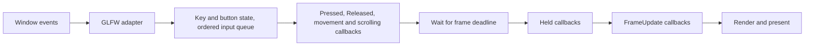

# Jade Events

Application owns a global main-thread dispatcher; each Scene owns a dispatcher for its controls, updates and lifecycle. Keyboard, mouse button, cursor and scroll callbacks collect state and queued input; application callbacks run from Run(), where they can change component state before rendering. This is cooperative event processing, with no user callbacks on another thread.

## Engine controls

```cpp
Jade::ApplicationConfig config;
config.debug = true; // F: wireframe, F3: axes, O: projection.
Jade::Application app(config);
// Create/select a scene camera, then install reusable controls.
scene->use<Jade::Module::FreeCameraControl>();
```

Include Jade/Module/FreeCameraControl.hpp or Jade/Jade.hpp. FreeCameraControl installs WASD/arrows, Shift/Ctrl+W, Space/Ctrl+Space, Q/E, left-button drag and wheel zoom. It resolves the selected camera for each event, uses dt for held motion, and resets dragging on camera changes and scene activation/deactivation. Missing components are skipped. Repeated use of the same module type on a Scene is a no-op; subscriptions remain across reactivation and expire with the Scene. See [module contracts and fixed control defaults](../README.md#scene-modules-and-controls).

For first-person controls, include Jade/Module/FPSCameraControl.hpp and use `scene->use<Jade::Module::FPSCameraControl>()` instead. It keeps WASD/arrows and Shift/Ctrl+W on the horizontal plane, captures the cursor for continuous mouse look, clamps pitch to +/-89 degrees and removes roll. Space, Ctrl+Space, Q/E and wheel are unbound; physics and jumping belong to a future character controller. A Scene rejects installing both control types. Both modules use the existing Scene::on events, skip missing components and release subscriptions with their Scene.

Unmodified KeyPressed I switches between RayTracing and Wireframe, including when debug is disabled. Repeats, modified keys and consumed events do not toggle it. F retains the same toggle when debug is enabled.

The Application debug flag defaults to false in both builds and is independent of Events/terminal logging. These shortcuts are default actions after global and scene propagation, so handlers can consume or override them without installing FreeCameraControl. FreeCameraControl can also be used with debug disabled.

## Public API

These examples show custom bindings; avoid installing equivalent callbacks alongside FreeCameraControl unless both actions are intended.

```cpp
auto scene = app.scene(); // Select a scene and explicit camera first.
auto camera = scene->camera();
auto& pose = camera.get<Jade::Transform>();
auto& lens = camera.get<Jade::Camera>();

scene->on<Jade::KeyHeld<"w">>([&] {
  Jade::Motion::forward(pose, 0.1f);
});

// Prefer seconds for consistent movement at different frame limits.
scene->on<Jade::KeyHeld<"S-w">>([&](const auto& event) {
  Jade::Motion::forward(pose, 6.0f * event.dt);
});

auto connection = scene->on<Jade::KeyPressed<"Space">>([] { /* once on press */ });
connection.disconnect();

scene->on<Jade::KeyReleased<"Space">>([] { /* once on release */ });
scene->on<Jade::FrameUpdate>([](const Jade::FrameUpdate& event) {
  // dt: seconds; elapsed: seconds since Run; frame: starts at 1.
});
bool dragging = false;
scene->on<Jade::MousePressed<"Left">>([&] { dragging = true; });
scene->on<Jade::MouseReleased<"Left">>([&] { dragging = false; });
scene->on<Jade::MouseHeld<"Right">>([](const auto& event) {
  // Runs once per frame while right is down; event.dt is seconds.
});
scene->on<Jade::MouseMoved>([&](const auto& mouse) {
  if (dragging) {
    Jade::Motion::yaw(pose, mouse.dx * 0.1);
    Jade::Motion::pitch(pose, -mouse.dy * 0.1);
  }
});
scene->on<Jade::MouseScrolled>([&](const auto& mouse) {
  Jade::Motion::zoom(lens, mouse.dy);
});
scene->on<Jade::KeyPressed<"o">>([&] {
  lens.projection = lens.projection == Jade::Projection::Perspective
    ? Jade::Projection::Orthographic : Jade::Projection::Perspective;
});
```

References used by a callback must remain alive until it is disconnected or its dispatcher owner is destroyed. Capture pose/lens references only while those components exist. Alternatively capture the Entity by value, check has<T>(), and get<T>() inside the callback; handles do not extend Scene lifetime. Callbacks may also hold values and move-only captures. Copying internal subscription snapshots preserves the original callback's mutable state.

## Global events and scene lifecycle

Use `scene->on` for scene controls and updates, and `app.on` for application-wide shortcuts. Every ordinary event visits global subscribers first, then the active scene. Stop in either layer suppresses the remaining matching subscribers and any default action. Registration order applies within each dispatcher. Inactive scenes keep components/cameras/subscriptions but receive no ordinary events.

```cpp
app.on<Jade::KeyPressed<"2">>([&] {
  app.setScene(secondScene);
  return Jade::EventFlow::Stop;
});
scene->on<Jade::SceneDeactivated>([&] { dragging = false; });
scene->on<Jade::SceneActivated>([&] { dragging = false; });
```

During Run, setScene queues selection until the next processing pass; input, update and rendering in the current pass retain the same Scene. The last request wins, including nullptr unload. Selection outside Run commits immediately. Selecting the current Scene emits no lifecycle events. One Scene can be active/reserved in only one Application.

SceneDeactivated runs before the active pointer changes; SceneActivated runs afterward. Stop ends lifecycle listener propagation without cancelling selection. Reentrant selection queues a later switch; Run inside lifecycle dispatch is rejected. A deactivation exception keeps the old selection; an activation exception keeps the new selection. Either clears pending requests and rethrows the original exception. Input/update exceptions also discard pending selection; normal bounded Run completion keeps it for the next Run.

First-frame dt after switching is zero; Run elapsed and frame indices continue. Physical held input persists, so a newly selected scene can receive Held without a preceding Pressed. Switching generates no synthetic release/press edges. Reset transient gestures such as dragging in lifecycle handlers. Application destruction releases ownership without lifecycle dispatch; an externally retained Scene can be selected by another Application afterward.

## Binding syntax

| Binding | Meaning |
| --- | --- |
| `w` | W without Control, Shift, Alt or Super |
| `Space` | Space without modifiers |
| `Up`, `Down`, `Left`, `Right` | Arrow keys |
| `C-w` | Control + W |
| `S-w` | Shift + W |
| `C-S-w` | Control + Shift + W |
| `A-w`, `M-w` | Alt + W, Super + W |

Names and prefixes are case-insensitive and prefix order is interchangeable. Modifiers must match exactly; this prevents a plain movement callback from also running alongside its faster Shift binding. Caps Lock and Num Lock are ignored. Named navigation keys, left/right modifiers, digits and F1-F12 are also supported. Empty names, repeated prefixes, missing keys and unknown names fail during template instantiation. These are physical key bindings rather than text input.

KeyString is a structural class value used as a non-type template parameter. This enables KeyHeld<"w"> using C++20's [class template parameter support](https://www.open-std.org/jtc1/sc22/wg21/docs/papers/2021/p2484r0.html); Jade exports the C++20 requirement to consumers through CMake.

MousePressed/MouseReleased/MouseHeld accept Left, Right, Middle and Button4-Button8, case-insensitively, using the same string-template mechanism. Unknown button names fail at compile time. Mouse bindings match the button regardless of keyboard modifiers; the callback still receives the modifier snapshot. This ensures a release ends a drag even if Shift or Control changed while dragging. Modifier prefixes are available for keyboard bindings only.

## Dispatch order and timing



Key/button Pressed/Released transitions, cursor movements and scroll offsets share one variant queue and are drained after each event poll, even while the window is minimized. Mixed input retains arrival order. A complete tap during the wait between frames still produces both transitions; a press, move and release all queued together still rotate only during that drag. GLFW_REPEAT is ignored. Held events use the current key/button/modifier state once per submitted frame and do not depend on OS repeat speed. Held keys run in key-enum order, then held buttons in button-enum order, then FrameUpdate; callbacks for one matching event run in registration order.

KeyEvent contains key, modifiers and dt; MouseEvent contains button, modifiers and dt. For edge events dt is zero. For Held it is seconds between actual frame starts, with zero for the first frame of Run, after a scene switch or after a zero-sized framebuffer. FrameUpdate uses the same interval plus elapsed and the upcoming submitted frame index. A callback that stops the application can prevent that frame from being submitted. Movement at a fixed amount per Held event depends on FPS; units-per-second times dt does not.

MouseMoved carries double-precision x/y and dx/dy in window coordinates, with X right and Y down. The first cursor sample after initialization or focus gain has zero delta, avoiding a jump from an unrelated cursor position. Nonfinite samples and cursor updates while unfocused are ignored.

MouseScrolled carries double-precision dx/dy scroll offsets. Horizontal scrolling uses dx, vertical scrolling uses dy, and fractional touchpad offsets are retained. Zero offsets, nonfinite input and scroll updates while unfocused are ignored. Cursor and scroll deltas already represent displacement, so do not multiply them by dt. Demo maps positive dy to zoom in and negative dy to zoom out, independently of whether the left button is held.

The backend installs [GLFW key, button, cursor, scroll and focus callbacks](https://www.glfw.org/docs/3.4/input_guide.html). Focus loss queues one release per held key and button, and clears all held/modifier state and the cursor baseline. GLFW's subsequent synthetic releases are ignored as duplicates. Modifiers come from the callback snapshot, including modifiers already held when the window gains focus. Minimized windows suspend Held/FrameUpdate callbacks and avoid a large movement step upon restoration.

## Motion

Motion is independent of the event dispatcher. Translation, rotation and direction functions take Transform; zoom takes Camera data. Helpers have no global state:

```cpp
Jade::Motion::forward(pose);  // Default distance: 0.1 world units.
Jade::Motion::backward(pose, 1.0f);
Jade::Motion::right(pose, 1.0f);
Jade::Motion::left(pose, 1.0f);
Jade::Motion::up(pose, 1.0f);
Jade::Motion::down(pose, 1.0f);
Jade::Motion::yaw(pose, 15.0);
Jade::Motion::pitch(pose, 10.0);
Jade::Motion::roll(pose, 5.0);
Jade::Motion::zoom(lens, 1.0); // One positive scroll offset: zoom in.
```

Forward/backward and right/left use Transform's current unit axes, including roll. Up/down follow parent Y even after banking. Moving position retains quaternion orientation without keeping a look-at target.

Angles are increments in degrees about the current local axes. Positive yaw turns right, positive pitch looks up and positive roll banks clockwise along front. Every increment composes and normalizes a quaternion; pitch can pass through the poles and complete a flip. Mouse yaw/pitch follows the banked axes after Q/E roll. Motion::lookAt(pose, target, up) replaces rotation once, with target/up in parent coordinates (world coordinates for a root). Mouse Y grows downward, so the example negates dy. Distances/angles must be finite; failed helper updates preserve prior state.

Zoom scales the active projection parameter by exp(-scroll * 0.1), bounding each scroll increment to [-100, 100]. Perspective FOV stays in [1, 179] degrees; orthographic visible height stays in [0.01, 10000] world units. The camera pose, projection mode and near/far planes stay intact. A zero increment leaves the camera unchanged, and nonfinite increments are rejected before mutation.

With config.debug enabled, Application handles unconsumed KeyPressed<"o"> to toggle the projection once per press. Assigning Camera::projection preserves perspective FOV and orthographic height independently, along with pose/clip planes. Invalid component data is rejected when consumed for zoom or rendering.

## Propagation and stopping

Callbacks return void to continue, or EventFlow::Stop to stop remaining matching subscribers for the current event. Keyboard edge and held events are separate: consuming Pressed does not suppress later Held events. FrameUpdate consumption stops later update subscribers while rendering proceeds normally.

```cpp
scene->on<Jade::KeyPressed<"Escape">>([] {
  // Consume Escape, for example while an application's menu handles it.
  return Jade::EventFlow::Stop;
});

scene->on<Jade::KeyPressed<"C-q">>([&] { app.stop(); });
```

With config.debug=true, unconsumed bare F, F3 and O toggle wireframe, unit axes and the retained scene camera projection once per press, logging actual changes at Info under Application. Repeat and Shift/Ctrl/Alt/Super combinations do not trigger these defaults. EventFlow::Stop in either dispatcher, app.stop() or a closed window prevents the action. O ignores absent or incomplete cameras and preserves both lens zoom values, pose and clip planes. Without debug these keys have no default action. Initial axes follow config.axisGizmo independently, and direct set/get APIs for wireframe and axes remain available.

Unconsumed Escape closes the window by default. stop() ends only the current Run, without closing the window, and can be followed by another Run. stop() also prevents Escape's default close action when called by an Escape callback. New runs reset timing and the stop request while retaining subscriptions, the selected Scene, Assets and current key state. A bounded Run explicitly stopped by a callback returns normally before reaching its frame limit.

## Subscription lifetime and mutation

on() returns EventConnection. Ignoring the result or destroying a handle leaves the callback registered, so a plain scene->on(...) expression works. disconnect() cancels it immediately; connected() reports its current state. Scene destruction expires scene connections; Application destruction expires global connections. An externally retained Scene keeps its subscriptions after Application destruction. Handles are safe to inspect or disconnect after expiry. All handle operations share the main-thread contract.

Dispatch snapshots shared slots. A callback registered during dispatch starts with the next dispatch, including another event in the same loop. Disconnected callbacks are skipped even if present in the snapshot. An executing callback survives cancellation until it returns. Dead slots are removed before the next connection or dispatch. No iterator into a callback container remains live across a user callback.

User callback exceptions propagate from Run; its running-state guard restores the ability to run again. Calling Run recursively from a callback throws logic_error. Backend callback failures are captured and rethrown after GLFW polling/waiting, keeping exceptions inside Jade's C++ control flow.

## Diagnostics

Dispatchers use `Events/Application` and `Events/Scene:<id>` Loggers and the process-wide minimum level.
Default Debug output records subscriptions, explicit cancellations observed during
pruning, and KeyPressed/KeyReleased/MousePressed/MouseReleased and scene lifecycle dispatches. Each
subscription receives a monotonically increasing ID within its dispatcher and a
canonical binding such as `KeyPressed<C-S-W>` or `MouseReleased<Left>`.

```text
15:27:07.591522 DEBUG [Events/Scene:1] - Subscribed: id=1 binding=KeyPressed<C-S-W>
15:27:08.591522 DEBUG [Events/Scene:1] - KeyPressed: binding=C-S-W handlers=1 consumed_by=1
15:27:09.591522 DEBUG [Events/Scene:1] - Disconnected: id=1 binding=KeyPressed<C-S-W>
```

`handlers` counts callbacks actually invoked, excluding nonmatching, disconnected
and skipped subscribers. `consumed_by` identifies the subscription returning
EventFlow::Stop; zero means propagation continued. This uses the same level as
the event, so a consumed FrameUpdate does not generate a per-frame Debug message.
Dispatch records are emitted after successful callbacks, including unhandled input
with zero handlers. Application default Escape and enabled F/F3/O actions run afterward.

KeyHeld, MouseHeld, MouseMoved, MouseScrolled and FrameUpdate use Trace, including
their relevant dt, position/deltas or frame index. Enable them explicitly with
`Jade::Log::SetLevel(Jade::Log::Level::Trace)`; set Info to hide routine Events
diagnostics. `ApplicationConfig::logPerformance` controls performance measurements,
independently of Events logging.

Callback failures emit Error with event, subscription ID, binding and exception
message; non-standard exceptions are identified explicitly. The original exception
is rethrown unchanged. If logging is Off, callbacks and exception propagation still
run normally. Logging sinks run after container mutation or against shared snapshots,
allowing connection/dispatch reentry under the same main-thread contract.

disconnect() remains immediate and noexcept; its diagnostic is emitted when the
next connection or dispatch prunes that slot. Repeated cancellation produces one
record. Dropping a handle or destroying a dispatcher owner does not emit a disconnection
record. Subscription IDs restart with each dispatcher and persist across Runs.

## Files and extension boundary

Input/Key.hpp, Input/MouseButton.hpp and Events/*.hpp contain only public input/event/connection contracts and the compile-time parsers. Graphics/Motion.hpp contains the public camera movement and zoom helpers with a matching source implementation. Module/FreeCameraControl.hpp and Module/FPSCameraControl.hpp expose reusable scene controls; their engine implementations use Scene::on and Motion. Application.hpp and Core/Scene.hpp adapt typed or argument-free callables. State, queues and dispatch storage live under src/internal/Input and src/internal/Events. The GLFW adapter lives under src/internal/Platform/GLFW. Camera, Transform and Mesh data depend on no input backend.

The current event set is keyboard/button transitions and held events, MouseMoved, MouseScrolled, FrameUpdate and scene-only SceneActivated/SceneDeactivated. Resize and text events can be added as separate event types and backend adapters without changing mesh/component contracts. The current on() reports unsupported event types at compile time.
