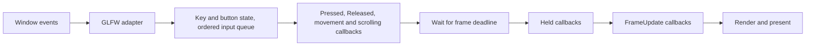

# Jade Events

Application owns a main-thread event dispatcher. Keyboard, mouse button, cursor and scroll callbacks collect state and queued input; application callbacks run from Run(), where they can change component state before rendering. This is cooperative event processing, with no user callbacks on another thread.

## Public API

```cpp
auto camera = app.camera();
auto& pose = camera.get<Jade::Transform>();
auto& lens = camera.get<Jade::Camera>();

app.on<Jade::KeyHeld<"w">>([&] {
  Jade::Motion::forward(pose, 0.1f);
});

// Prefer seconds for consistent movement at different frame limits.
app.on<Jade::KeyHeld<"S-w">>([&](const auto& event) {
  Jade::Motion::forward(pose, 6.0f * event.dt);
});

auto connection = app.on<Jade::KeyPressed<"Space">>([] { /* once on press */ });
connection.disconnect();

app.on<Jade::KeyReleased<"Space">>([] { /* once on release */ });
app.on<Jade::FrameUpdate>([](const Jade::FrameUpdate& event) {
  // dt: seconds; elapsed: seconds since Run; frame: starts at 1.
});
bool dragging = false;
app.on<Jade::MousePressed<"Left">>([&] { dragging = true; });
app.on<Jade::MouseReleased<"Left">>([&] { dragging = false; });
app.on<Jade::MouseHeld<"Right">>([](const auto& event) {
  // Runs once per frame while right is down; event.dt is seconds.
});
app.on<Jade::MouseMoved>([&](const auto& mouse) {
  if (dragging) {
    Jade::Motion::yaw(pose, mouse.dx * 0.1);
    Jade::Motion::pitch(pose, -mouse.dy * 0.1);
  }
});
app.on<Jade::MouseScrolled>([&](const auto& mouse) {
  Jade::Motion::zoom(lens, mouse.dy);
});
app.on<Jade::KeyPressed<"o">>([&] {
  lens.projection = lens.projection == Jade::Projection::Perspective
    ? Jade::Projection::Orthographic : Jade::Projection::Perspective;
});
```

References used by a callback must remain alive until it is disconnected or Application is destroyed. Capture pose/lens references only while those components exist. Alternatively capture the Entity by value, check has<T>(), and get<T>() inside the callback; handles do not extend World lifetime. Callbacks may also hold values and move-only captures. Copying internal subscription snapshots preserves the original callback's mutable state.

## Binding syntax

| Binding | Meaning |
| --- | --- |
| `w` | W without Control, Shift, Alt or Super |
| `Space` | Space without modifiers |
| `Up`, `Down`, `Left`, `Right` | Arrow keys |
| `C-w` | Control + W |
| `S-w` | Shift + W |
| `C-S-w` | Control + Shift + W |
| `A-w`, `M-w` | Alt + W, Super + W |

Names and prefixes are case-insensitive and prefix order is interchangeable. Modifiers must match exactly; this prevents a plain movement callback from also running alongside its faster Shift binding. Caps Lock and Num Lock are ignored. Named navigation keys, left/right modifiers, digits and F1-F12 are also supported. Empty names, repeated prefixes, missing keys and unknown names fail during template instantiation. These are physical key bindings rather than text input.

KeyString is a structural class value used as a non-type template parameter. This enables KeyHeld<"w"> using C++20's [class template parameter support](https://www.open-std.org/jtc1/sc22/wg21/docs/papers/2021/p2484r0.html); Jade exports the C++20 requirement to consumers through CMake.

MousePressed/MouseReleased/MouseHeld accept Left, Right, Middle and Button4-Button8, case-insensitively, using the same string-template mechanism. Unknown button names fail at compile time. Mouse bindings match the button regardless of keyboard modifiers; the callback still receives the modifier snapshot. This ensures a release ends a drag even if Shift or Control changed while dragging. Modifier prefixes are available for keyboard bindings only.

## Dispatch order and timing



Key/button Pressed/Released transitions, cursor movements and scroll offsets share one variant queue and are drained after each event poll, even while the window is minimized. Mixed input retains arrival order. A complete tap during the wait between frames still produces both transitions; a press, move and release all queued together still rotate only during that drag. GLFW_REPEAT is ignored. Held events use the current key/button/modifier state once per submitted frame and do not depend on OS repeat speed. Held keys run in key-enum order, then held buttons in button-enum order, then FrameUpdate; callbacks for one matching event run in registration order.

KeyEvent contains key, modifiers and dt; MouseEvent contains button, modifiers and dt. For edge events dt is zero. For Held it is seconds between actual frame starts, with zero for the first frame of Run or after a zero-sized framebuffer. FrameUpdate uses the same interval plus elapsed and the upcoming submitted frame index. A callback that stops the application can prevent that frame from being submitted. Movement at a fixed amount per Held event depends on FPS; units-per-second times dt does not.

MouseMoved carries double-precision x/y and dx/dy in window coordinates, with X right and Y down. The first cursor sample after initialization or focus gain has zero delta, avoiding a jump from an unrelated cursor position. Nonfinite samples and cursor updates while unfocused are ignored.

MouseScrolled carries double-precision dx/dy scroll offsets. Horizontal scrolling uses dx, vertical scrolling uses dy, and fractional touchpad offsets are retained. Zero offsets, nonfinite input and scroll updates while unfocused are ignored. Cursor and scroll deltas already represent displacement, so do not multiply them by dt. Demo maps positive dy to zoom in and negative dy to zoom out, independently of whether the left button is held.

The backend installs [GLFW key, button, cursor, scroll and focus callbacks](https://www.glfw.org/docs/3.4/input_guide.html). Focus loss queues one release per held key and button, and clears all held/modifier state and the cursor baseline. GLFW's subsequent synthetic releases are ignored as duplicates. Modifiers come from the callback snapshot, including modifiers already held when the window gains focus. Minimized windows suspend Held/FrameUpdate callbacks and avoid a large movement step upon restoration.

## Motion

Motion is independent of the event dispatcher. Translation, rotation and direction functions take Transform; zoom takes Camera data. Helpers have no global state:

```cpp
Jade::Motion::forward(pose);  // Default distance: 0.1 world units.
Jade::Motion::backward(pose, 1.0f);
Jade::Motion::right(pose, 1.0f);
Jade::Motion::left(pose, 1.0f);
Jade::Motion::up(pose, 1.0f);
Jade::Motion::down(pose, 1.0f);
Jade::Motion::yaw(pose, 15.0);
Jade::Motion::pitch(pose, 10.0);
Jade::Motion::roll(pose, 5.0);
Jade::Motion::zoom(lens, 1.0); // One positive scroll offset: zoom in.
```

Forward/backward and right/left use Transform's current unit axes, including roll. Up/down follow world Y even after banking. Moving position retains quaternion orientation without keeping a look-at target.

Angles are increments in degrees about the current local axes. Positive yaw turns right, positive pitch looks up and positive roll banks clockwise along front. Every increment composes and normalizes a quaternion; pitch can pass through the poles and complete a flip. Mouse yaw/pitch follows the banked axes after Q/E roll. Motion::lookAt(pose, target, up) replaces rotation once. Mouse Y grows downward, so the example negates dy. Distances/angles must be finite; failed helper updates preserve prior state.

Zoom scales the active projection parameter by exp(-scroll * 0.1), bounding each scroll increment to [-100, 100]. Perspective FOV stays in [1, 179] degrees; orthographic visible height stays in [0.01, 10000] world units. The camera pose, projection mode and near/far planes stay intact. A zero increment leaves the camera unchanged, and nonfinite increments are rejected before mutation.

Demo uses KeyPressed<"o"> to toggle the projection once per press. Assigning Camera::projection preserves perspective FOV and orthographic height independently, along with pose/clip planes. Invalid component data is rejected when consumed for zoom or rendering.

## Propagation and stopping

Callbacks return void to continue, or EventFlow::Stop to stop remaining matching subscribers for the current event. Keyboard edge and held events are separate: consuming Pressed does not suppress later Held events. FrameUpdate consumption stops later update subscribers while rendering proceeds normally.

```cpp
app.on<Jade::KeyPressed<"Escape">>([] {
  // Consume Escape, for example while an application's menu handles it.
  return Jade::EventFlow::Stop;
});

app.on<Jade::KeyPressed<"C-q">>([&] { app.stop(); });
```

Unconsumed bare F3 toggles the default unit Axis Gizmo once per press and logs its state. Shift/Ctrl/Alt/Super+F3 does not trigger that default. Returning EventFlow::Stop from an F3 handler or calling app.stop() prevents the toggle. Applications can also use config.axisGizmo, app.setAxisGizmo(bool) and app.axisGizmoEnabled().

Unconsumed Escape closes the window by default. stop() ends only the current Run, without closing the window, and can be followed by another Run. stop() also prevents Escape's default close action when called by an Escape callback. New runs reset timing and the stop request while retaining subscriptions, World, Assets and current key state. A bounded Run explicitly stopped by a callback returns normally before reaching its frame limit.

## Subscription lifetime and mutation

on() returns EventConnection. Ignoring the result or destroying a handle leaves the callback registered, so a plain app.on(...) expression works. disconnect() cancels it immediately; connected() reports its current state. Application destruction expires all handles. Handles are safe to inspect or disconnect after expiry. All handle operations share the main-thread contract.

Dispatch snapshots shared slots. A callback registered during dispatch starts with the next dispatch, including another event in the same loop. Disconnected callbacks are skipped even if present in the snapshot. An executing callback survives cancellation until it returns. Dead slots are removed before the next connection or dispatch. No iterator into a callback container remains live across a user callback.

User callback exceptions propagate from Run; its running-state guard restores the ability to run again. Calling Run recursively from a callback throws logic_error. Backend callback failures are captured and rethrown after GLFW polling/waiting, keeping exceptions inside Jade's C++ control flow.

## Files and extension boundary

Input/Key.hpp, Input/MouseButton.hpp and Events/*.hpp contain only public input/event/connection contracts and the compile-time parsers. Graphics/Motion.hpp contains the public camera movement and zoom helpers with a matching source implementation. Application.hpp adapts typed or argument-free callables. State, queues and dispatch storage live under src/internal/Input and src/internal/Events. The GLFW adapter lives under src/internal/Platform/GLFW. Camera, Transform and Mesh data depend on no input backend.

The current event set is keyboard/button transitions and held events, MouseMoved, MouseScrolled and FrameUpdate. Resize and text events can be added as separate event types and backend adapters without changing mesh/component contracts. The current on() reports unsupported event types at compile time.
