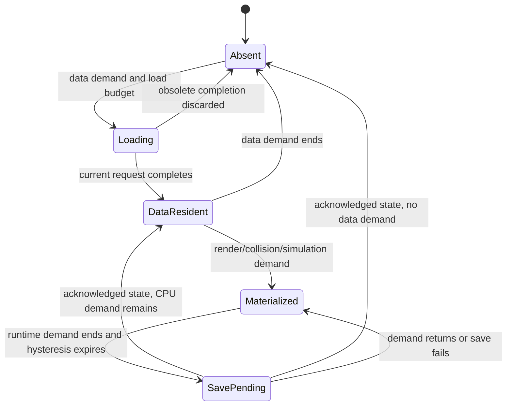

# World Runtime contracts

## World, Registry and Scene

`Jade::World` owns one ECS Registry, hierarchy policy, streaming manager, command queue and native physics state. It can be constructed and ticked without Application or Scene. `Scene(shared_ptr<World>)` rejects null, references the World and owns only camera selection, navigation, local events and modules. The same World can be viewed through multiple Scenes without duplicating entities or resetting body identity.

Runtime accepts `addWorld`/`removeWorld`. Registration is idempotent in one Runtime and rejects ownership by another Runtime. Its active Scene implicitly adds that World to the tick set, with deduplication. Explicit registration persists after Scene deactivation. Remove first detaches the active Scene, saves the World and releases its Runtime ownership. Runtime shutdown drains accepted jobs and detaches pointers from Worlds that external shared owners retain.

World tick ordering is fixed gameplay → command commit → physics synchronize/advance/publish, per substep. Worlds without a gameplay callback synchronize/publish once around the fixed loop. Streaming publication precedes the fixed loop; ownership migration follows it. Animation runs before the active Scene snapshot. `setFixedUpdate` installs the game's World callback; owners must clear callbacks before captured game objects are destroyed. Contact/force publication belongs to each World even when multiple Worlds share one Physics bridge. World and Registry are owner-thread APIs, not concurrently mutable containers.

## Component access and structural changes

`world.create<T>()` and `registry.create<T>()` default-construct exactly the flattened Archetype descriptor components. Manual create/add supports non-default component constructors. `query` snapshots sorted identities; `each` traverses cached groups directly. References stay stable until that component is removed or its owner is destroyed. No component type is moved to pack an archetype column.

Structural operations during `each` throw. `world.command(callback)` queues owner-thread work; `commit()` requires a traversal boundary. Commands queued by a running command wait until the next commit. Value-only `patch<T>`/`markChanged` increment an entity revision. Raw `get` edits are read by current render/save capture even without revision marking.

Hierarchy reparenting retains local TRS and attachment order. Attached subtrees immediately inherit the streamed parent's Residency. Destroy invalidates the full subtree before running any component destructor. Persistent object roots cannot become children; streamed children cannot escape their owner or attach across Chunks. Ordinary roots, including player, camera, sun and boundary colliders, remain outside streaming ownership.

## Authored data and runtime state

`ChunkCoord{x,z}` indexes square XZ regions. `chunkAt` uses mathematical floor, including negative coordinates, and rejects nonfinite inputs, invalid size and integer overflow. Provider bounds define finite or infinite availability; absence beyond bounds is not a load failure.

`ChunkProvider::load(coord)` returns immutable `ChunkData` containing stable object IDs, codec type, versioned JSON state, persistent flag and dynamic flag. Providers are concurrent pure CPU operations. They do not read Registry or Assets or issue graphics commands. Containment is a noexcept boundary query.

An `ObjectCodec` receives the supplied root and creates attached children. It captures root state and any child data that must persist. Codecs execute on the World owner thread. Spawn failure rolls back the root and attached subtree. Arbitrary unattached entities created by a codec are outside that rollback contract. Duplicate IDs, unknown codecs, malformed JSON or mismatched returned coordinates are load errors.

The persisted overlay combines authored objects with runtime changes. Deleted roots leave tombstones. A moved object is suppressed in its authored source and inserted at its saved destination. One ObjectId denotes one root within one WorldId; game code allocates new IDs uniquely before `track`. Tracking requires a live unparented root in a materialized Chunk with a registered codec, applies current Residency immediately and rejects known persistent ID reuse. Child persistence belongs to the root codec.

`ObjectRef{world,object}` is the persistence reference. `resolve` returns an Entity only while that root is resident. Entity generations change after unload/reload; ObjectRef does not. Entity IDs, pointers, asset handles and GPU state are not serialized.

## Demand and transitions

Demand dimensions are independent within `dataRadius`, which is limited to 0–128. A runtime radius of -1 disables that dimension for a source. Sources use Chebyshev distance, forming clipped square regions. Defaults data=2, render=2, collision=2, simulation=1 produce 25 resident/static-collision/render Chunks and 9 active Chunks away from provider edges. Multiple sources union each dimension independently.

Data-only Chunks retain CPU data without entities. Materialized static roots collide when collision demand is enabled. Dynamic roots render under render demand, but collision and physics/animation require simulation demand. Frozen roots retain Transform, RigidBody velocities and persistent identity. Non-streamed entities have no Residency component and participate normally.

Missing collision data reports `ready(coord)==false`. `ready(coord,false)` checks CPU data residence. Untitled gates movement until current and destination collision Chunks are ready. Readiness is not a promise that individual dynamic roots participate outside their simulation radius.

## Async budgets, failures and barriers

Defaults allow four accepted load tasks, two Chunk publications/promotions and two releases per manager update. These are per-update, per-World budgets. Nearest sources receive loading priority. Requests carry a configuration session; only matching current demand can publish. Running obsolete loads finish safely and their results are dropped. Resident capacity bounds Chunk data plus accepted loads; memory pressure can bypass release hysteresis for unneeded Chunks, but cannot bypass durable-save acknowledgement.

The one-second hysteresis delays releasing entities/data after demand disappears. Dematerialization can retain prefetched CPU data. Migration pins the source and missing destination until the destination is materialized, preventing an object from losing its sole runtime copy. Pending roots freeze and stop colliding; a save records the actual destination so restart can restore them there before the in-memory transfer finishes. Migration across finite provider bounds is unsupported; game code must constrain objects, as Untitled's boundary colliders do.

Ordinary `update` never waits for provider/store I/O. Startup/controlled teleport code can call `barrier`, which waits accepted tasks and commits incrementally. Demand beyond `maxResidentChunks` produces an explicit error. Statistics expose data/render/collision/active/loading/frozen counts, save activity, successful save commits and the latest error. Failed coordinate requests remain blocked until `retry`; save failures retain state and can retry. Configuration happens once before loading; replacing a provider/store requires a new World.

Jobs are optional: without a supplied JobSystem, providers and saves run synchronously for headless/serial use. An injected JobSystem must outlive the manager, unless Runtime drains it and detaches pointers. Save checkpoints default to five seconds. A save requested while another runs schedules a later capture rather than blocking the frame.

## Save acknowledgement and restart

`save()` captures live persistent roots and overlays on the owner thread, then submits immutable state to the Store. Before dematerialization/release, the manager waits across updates for a successful acknowledgement and verifies current captured state still equals that snapshot. New edits invalidate the release ticket. Save failure retains frozen entities and the complete memory copy; no required persistent state is silently discarded.

`world.save()` is an explicit blocking save boundary: it flushes earlier work, captures the current state and flushes the new save. Normal Runtime finish invokes it for explicit and active implicit Worlds. A destructor does not initiate file I/O or hide save failures. Error-aborted runs may omit the final save; the last successful checkpoint remains authoritative.

FileWorldStore version 1 writes one immutable `snapshot-*.json` containing all object states and ownership coordinates, flushes it to disk, then writes/flushed `commit.pending` and atomically replaces `commit.json` using Windows replacement/write-through semantics. Source overrides and destination records are committed together. Restart reads only the referenced snapshot; pending files and unreferenced snapshots are ignored. Corruption, wrong WorldId or incompatible schema throws rather than resetting the world silently.

The current and previous snapshot generations remain on disk; older owned snapshot files are best-effort cleaned after commit. This is a single-writer store for local Windows filesystems. It does not provide cross-process concurrent editing, cloud synchronization, distributed transactions, arbitrary schema migration or automatic reflection of unknown components.

## Untitled v0.1

Authored data contains 16x16 Chunks of 16x16 metres, with 4x4 grass cells per Chunk. The 256-metre square map is read from WorldConfig and 256 Chunk JSON files. Grass uses nonpersistent roots with 16 analytic plane children and one static thin Box floor. Three ball representations share a sphere Collider: low polygon mesh, analytic sphere, high polygon mesh.

Player starts at (136, 0.35, 136), in Chunk (8,8). Its character controller has no RigidBody and uses camera-relative fixed-step movement. Q/E rotate the orthographic view; F pushes the nearest active ball within five metres; X deletes it; R resets player/camera without erasing persistent ball changes. The HUD displays demand counts, load/freeze/save status and errors.

Production saves to `UntitledSaves` beside the executable. Tests omit the store unless explicitly checking persistence. Ball codecs persist position, rotation, linear/angular velocity and visual representation; world physics bindings are reconstructed from that data after reload. Assets are shared at Runtime scope, so normal streaming does not reload identical mesh or sprite resources.
